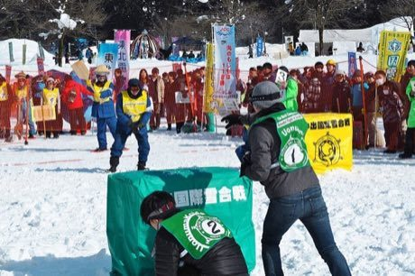

# Yukigassen Snow Fort

*Yukigassen 雪合戦*

**Encyclopedia ID 71** (permanent) · https://equalinformation.com/world-heritage-games-site/games/71-yukigassen-snow-fort/

*Photo: Uonuma tourism association, [CC BY 4.0](https://creativecommons.org/licenses/by/4.0/), [source on Wikimedia Commons](https://commons.wikimedia.org/wiki/File:UonumaPhoto_Yukigassen_Koide_Snowball_Fight_Meet_201802.jpg)*

Two teams of seven throw snowballs from behind snow walls; hit opponents out or capture their flag.

## Heritage note

Part of the living heritage of Japan.

## Origins

Usually placed in the era of Modern Heritage (1800 to today), although its exact origins are uncertain, within the cultural world of Japan and Korea.

## Facts

- **Where:** Japan
- **Type:** Water and winter sports
- **Family:** Winter sports
- **Era:** [Modern Heritage](../../eras/modern/index.md) (uncertain)
- **Cradle:** [Japan and Korea](../../cradles/japan-korea/index.md)
- **Region:** East and Southeast Asia

## Related entries

- [Takoyaki-style ball flipping](../../games/352-takoyaki-style-ball-flipping/index.md)
- [Chinlone](../../games/16-chinlone/index.md)
- [Pinata swing](../../games/61-pinata-swing/index.md)
- [Ring Tilting](../../games/65-ring-tilting/index.md)
- [Bagatelle](../../games/72-bagatelle/index.md)
- [Plate Spinning](../../games/73-plate-spinning/index.md)

## Sources

- <https://commons.wikimedia.org/wiki/File:UonumaPhoto_Yukigassen_Koide_Snowball_Fight_Meet_201802.jpg>
