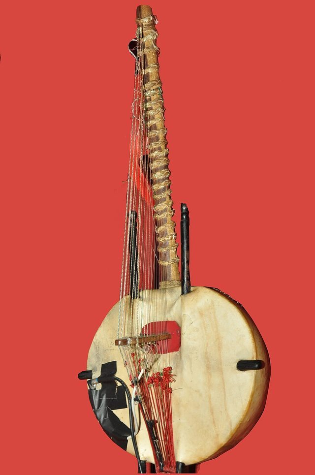

# Kora

**Encyclopedia ID 7176** (permanent) · https://bpupadhyaya.github.io/world-heritage-games-site/games/7176-kora/

*Photo: KannanShanmugamstudio,Main Road,Kollam, [CC BY-SA 3.0](https://creativecommons.org/licenses/by-sa/3.0/), [source on Wikimedia Commons](https://commons.wikimedia.org/wiki/File:Kora_DSC_0355.JPG)*

A 21-string bridge harp-lute with a large calabash body, associated with Mande hereditary musicians of the Senegambia region.

## Heritage note

Part of the living heritage of Gambia.

## Origins

Usually placed in the era of Classical Worlds (about 1000 BCE to 500 CE), although its exact origins are uncertain, within the cultural world of Africa: Sahel, West and Central.

## Facts

- **Where:** Gambia, Mali, Senegal
- **Type:** Musical instruments
- **Family:** String instruments
- **Era:** [Classical Worlds](../../eras/classical/index.md) (uncertain)
- **Cradle:** [Africa: Sahel, West and Central](../../cradles/africa-west/index.md)
- **Region:** Sub-Saharan Africa

## Play it

[Try a 90-second preview in your browser](https://bpupadhyaya.github.io/games-site/games/kora-twenty-one-strings/play/) · [Google Play](https://play.google.com/store/apps/details?id=com.equalinformation.arcforge.shell) · [App Store](https://apps.apple.com/us/app/arcforge-world-heritage-games/id6813746442)

## Related entries

- [Imzad Fiddle](../../games/1301-imzad-fiddle/index.md)
- [Fula Riti One-String Fiddle](../../games/1283-fula-riti-one-string-fiddle/index.md)
- [Mvet](../../games/1420-mvet/index.md)
- [Morin khuur](../../games/34-morin-khuur/index.md)
- [String Marionette Theatre](../../games/68-string-marionette-theatre/index.md)
- [Kathputli string puppets](../../games/79-kathputli-string-puppets/index.md)

## Sources

- <https://en.wikipedia.org/wiki/Kora_(instrument)>
