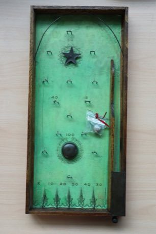

# Bagatelle

*Also known as: pin table*

**Encyclopedia ID 72** (permanent) · https://bpupadhyaya.github.io/world-heritage-games-site/games/72-bagatelle/

*Photo: Olivier Merly, responsable du Fonds Patrimonial du Jeu de Société, [Public domain](https://creativecommons.org/publicdomain/mark/1.0/), [source on Wikimedia Commons](https://commons.wikimedia.org/wiki/File:Bagatelle_(1910).jpg)*

Pull the spring plunger and shoot a ball up a pin-studded board into numbered cups, scoring for each.

## Heritage note

Part of the living heritage of France, United Kingdom.

## Origins

Usually placed in the era of Modern Heritage (1800 to today), although its exact origins are uncertain, within the cultural world of Celtic and Atlantic Europe.

## Facts

- **Where:** France, United Kingdom
- **Type:** Dexterity and skill games
- **Family:** Winter sports
- **Era:** [Modern Heritage](../../eras/modern/index.md) (uncertain)
- **Cradle:** [Celtic and Atlantic Europe](../../cradles/celtic-atlantic/index.md)
- **Region:** Europe

## Related entries

- [Bat and Trap](../../games/405-bat-and-trap/index.md)
- [Bridge Stick Race](../../games/468-bridge-stick-race/index.md)
- [Curling](../../games/1181-curling/index.md)
- [Harbour Street Circuit Time Trial](../../games/1475-harbour-street-circuit-time-trial/index.md)
- [Chinlone](../../games/16-chinlone/index.md)
- [Pinata swing](../../games/61-pinata-swing/index.md)

## Sources

- <https://commons.wikimedia.org/wiki/File:Bagatelle_(1910).jpg>
