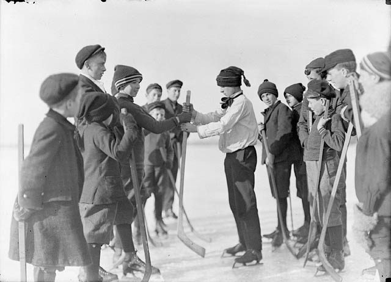

# Shinny

*Also known as: Double ball · Hoop and stick · Pond hockey*

**Encyclopedia ID 725** (permanent) · https://bpupadhyaya.github.io/world-heritage-games-site/games/725-shinny/

*Photo: John Boyd, [Public domain](https://creativecommons.org/publicdomain/mark/1.0/), [source on Wikimedia Commons](https://commons.wikimedia.org/wiki/File:Sarnia_Shinny.jpg)*

Informal stick-and-ball team game on field or ice, parent of modern hockey in some narratives.

## Heritage note

Part of the living heritage of United States, Canada.

## Origins

Usually placed in the era of Modern Heritage (1800 to today), although its exact origins are uncertain, within the cultural world of The Americas: North America.

## Facts

- **Where:** United States, Canada
- **Type:** Street and playground games
- **Family:** Stick-and-ball games
- **Era:** [Modern Heritage](../../eras/modern/index.md) (uncertain)
- **Cradle:** [The Americas: North America](../../cradles/north-america/index.md)
- **Region:** Americas
- **Players:** teams

## Play it

[Web preview](https://bpupadhyaya.github.io/games-site/games/pond-hockey-slide/) · [Google Play](https://play.google.com/store/apps/details?id=com.equalinformation.arcforge.shell) · [App Store](https://apps.apple.com/us/app/arcforge-world-heritage-games/id6813746442)

## Related entries

- [Tikhi](../../games/876-tikhi/index.md)
- [Double Dutch](../../games/53-double-dutch/index.md)
- [Square dance caller](../../games/129-square-dance-caller/index.md)
- [Tractor pull](../../games/440-tractor-pull/index.md)
- [Axe throwing](../../games/442-axe-throwing/index.md)
- [Crokinole](../../games/623-crokinole/index.md)

## Sources

- <https://www.ebsco.com/research-starters/sports-and-leisure/native-american-games-and-contests/>
