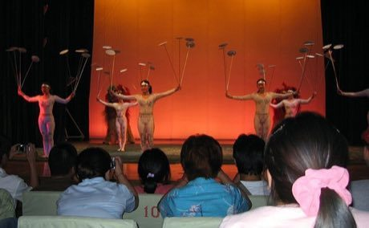

# Plate Spinning

*Also known as: 杂技转碟 · Chinese acrobatic sticks*

**Encyclopedia ID 73** (permanent) · https://bpupadhyaya.github.io/world-heritage-games-site/games/73-plate-spinning/

*Photo: Bernard McManus, [CC BY 2.0](https://creativecommons.org/licenses/by/2.0/), [source on Wikimedia Commons](https://commons.wikimedia.org/wiki/File:Plate_Spinning_at_Acrobatics_show_in_Beijing_(5399920080).jpg)*

Many plates spin on thin poles.

## Heritage note

Part of the living heritage of China.

## Origins

Usually placed in the era of Modern Heritage (1800 to today), although its exact origins are uncertain, within the cultural world of China.

## Facts

- **Where:** China
- **Type:** Dexterity and skill games
- **Family:** Winter sports
- **Era:** [Modern Heritage](../../eras/modern/index.md) (uncertain)
- **Cradle:** [China](../../cradles/china/index.md)
- **Region:** East and Southeast Asia

## Play it

[Try a 90-second preview in your browser](https://bpupadhyaya.github.io/games-site/games/plate-spinning/play/) · [Google Play](https://play.google.com/store/apps/details?id=com.equalinformation.arcforge.shell) · App Store (coming soon)

## Related entries

- [Chinlone](../../games/16-chinlone/index.md)
- [Pinata swing](../../games/61-pinata-swing/index.md)
- [Ring Tilting](../../games/65-ring-tilting/index.md)
- [Yukigassen Snow Fort](../../games/71-yukigassen-snow-fort/index.md)
- [Bagatelle](../../games/72-bagatelle/index.md)
- [Tent pegging](../../games/78-tent-pegging/index.md)

## Sources

- <https://commons.wikimedia.org/wiki/File:Plate_Spinning_at_Acrobatics_show_in_Beijing_(5399920080).jpg>
