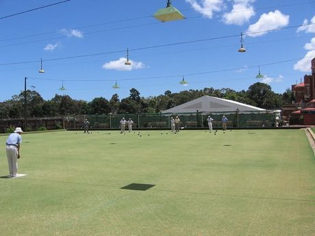

# Lawn bowls

*Lawn bowls · biased-bowl green*

**Encyclopedia ID 74** (permanent) · https://bpupadhyaya.github.io/world-heritage-games-site/games/74-lawn-bowls/

*Photo: PookieFugglestein, [CC0](https://creativecommons.org/publicdomain/zero/1.0/), [source on Wikimedia Commons](https://commons.wikimedia.org/wiki/File:Lawn_Bowls.JPG)*

Roll biased bowls so they curve in toward a small white jack; the closest bowls to the jack score, and you can nudge or knock rivals aside.

## Heritage note

Part of the living heritage of United Kingdom, Australia, New Zealand.

## Origins

Usually placed in the era of Classical Worlds (about 1000 BCE to 500 CE), although its exact origins are uncertain, within the cultural world of Celtic and Atlantic Europe.

## Facts

- **Where:** United Kingdom, Australia, New Zealand
- **Type:** Dexterity and skill games
- **Family:** Archery and target games
- **Era:** [Classical Worlds](../../eras/classical/index.md) (uncertain)
- **Cradle:** [Celtic and Atlantic Europe](../../cradles/celtic-atlantic/index.md)
- **Region:** Europe

## Related entries

- [Krulbol](../../games/1469-krulbol/index.md)
- [Boules lyonnaises](../../games/730-boules-lyonnaises/index.md)
- [Provencal boules](../../games/939-provencal-boules/index.md)
- [Horseshoe pitching](../../games/50-horseshoe-pitching/index.md)
- [Mounted Archery Course](../../games/67-mounted-archery-course/index.md)
- [Mongolian Bow Archery](../../games/1476-mongolian-bow-archery/index.md)

## Sources

- <https://commons.wikimedia.org/wiki/File:Lawn_Bowls.JPG>
