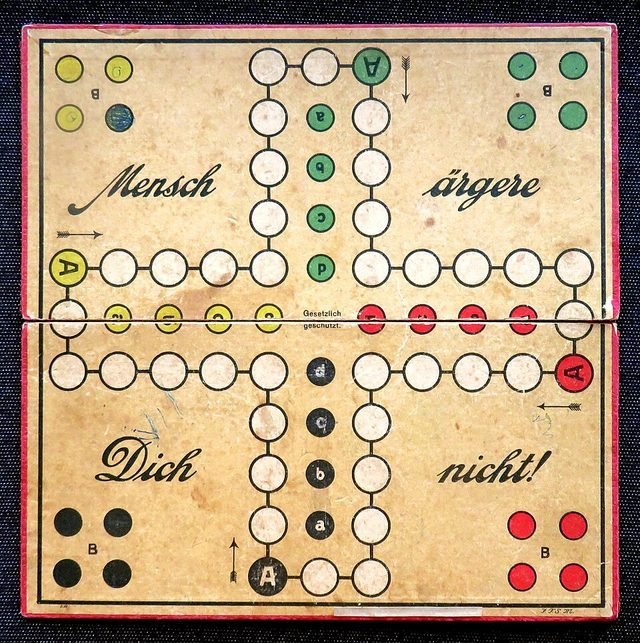

# Don't Get Angry

*Also known as: Mensch ärgere Dich nicht · Ludo*

**Encyclopedia ID 744** (permanent) · https://bpupadhyaya.github.io/world-heritage-games-site/games/744-dont-get-angry/

*Photo: Vitavia, [CC BY-SA 4.0](https://creativecommons.org/licenses/by-sa/4.0/), [source on Wikimedia Commons](https://commons.wikimedia.org/wiki/File:Mensch%C3%84rgereDichNicht_Germany1929_front.jpg)*

Cross-and-circle race game with sent-home captures, derived from Ludo/Pachisi.

## Heritage note

Part of the living heritage of Germany.

## Origins

Usually placed in the era of River Valleys and First Cities (about 3000 to 1000 BCE), although its exact origins are uncertain, within the cultural world of Northern and Eastern Europe.

## Facts

- **Where:** Germany
- **Type:** Board and table games
- **Family:** Race and cross games
- **Era:** [River Valleys and First Cities](../../eras/river-valleys/index.md) (uncertain)
- **Cradle:** [Northern and Eastern Europe](../../cradles/north-east-europe/index.md)
- **Region:** Europe
- **Players:** 2-4

## Related entries

- [Table](../../games/1044-table/index.md)
- [Nardy](../../games/1047-nardy/index.md)
- [Nardi](../../games/551-nardi/index.md)
- [Tavli](../../games/656-tavli/index.md)
- [Senet](../../games/693-senet/index.md)
- [Ludo](../../games/763-ludo/index.md)

## Sources

- <https://en.wikipedia.org/wiki/Mensch_%C3%A4rgere_Dich_nicht>
