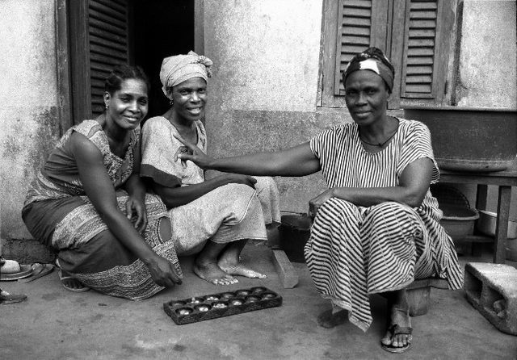

# Oware

*Also known as: Oware (Akan: 'he marries') · Awale · Warri · Adi (Ewe) · Awele (Ga)*

**Encyclopedia ID 749** (permanent) · https://bpupadhyaya.github.io/world-heritage-games-site/games/749-oware/

*Photo: No machine-readable author provided. Perrona assumed (based on copyright claims)., [CC BY 2.5](https://creativecommons.org/licenses/by/2.5/), [source on Wikimedia Commons](https://commons.wikimedia.org/wiki/File:Awale.jpg)*

Sowing and capture on a 2x6 board; the national mancala game of Ghana with strong social/onlooker culture.

## Heritage note

Part of the living heritage of Ghana.

## Origins

Usually placed in the era of Deep Past and First Games (before about 3000 BCE), although its exact origins are uncertain, within the cultural world of Africa: Sahel, West and Central.

## Facts

- **Where:** Ghana
- **Type:** Board and table games
- **Family:** Mancala and sowing games
- **Era:** [Deep Past and First Games](../../eras/deep-past/index.md) (uncertain)
- **Cradle:** [Africa: Sahel, West and Central](../../cradles/africa-west/index.md)
- **Region:** Sub-Saharan Africa
- **Players:** 2

## Play it

[Try a 90-second preview in your browser](https://bpupadhyaya.github.io/games-site/games/oware-seed-sowing/play/) · [Google Play](https://play.google.com/store/apps/details?id=com.equalinformation.arcforge.shell) · [App Store](https://apps.apple.com/us/app/arcforge-world-heritage-games/id6813746442)

## Related entries

- [Songo](../../games/617-songo/index.md)
- [Kisolo](../../games/666-kisolo/index.md)
- [Oware-family mancala](../../games/587-oware-family-mancala/index.md)
- [Ouril](../../games/611-ouril/index.md)
- [Mancala-type sowing games](../../games/626-mancala-type-sowing-games/index.md)
- [Sija](../../games/627-sija/index.md)

## Sources

- <https://en.wikipedia.org/wiki/Oware>
- <https://mancala.fandom.com/wiki/Oware>
- <https://sport.interactiveatlas.org/games/oware>
