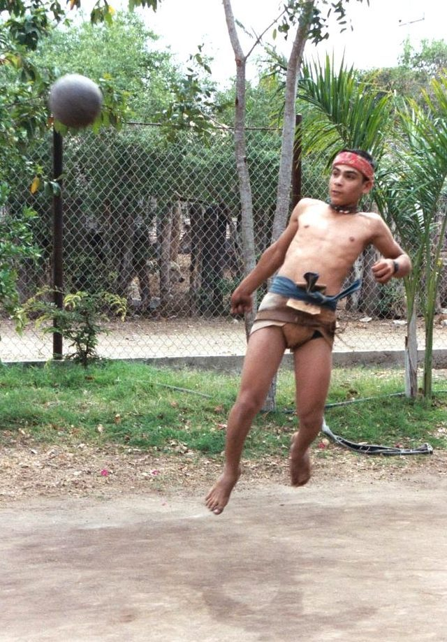

# Mesoamerican ballgame

*Also known as: Ulama · Ulama (Mesoamerican ballgame, modern)*

**Encyclopedia ID 759** (permanent) · https://bpupadhyaya.github.io/world-heritage-games-site/games/759-mesoamerican-ballgame/

*Photo: Photograph: Manuel Aguilar-Moreno / CSULA Ulama Project, [CC BY 2.5](https://creativecommons.org/licenses/by/2.5/), [source on Wikimedia Commons](https://commons.wikimedia.org/wiki/File:Ulama_37_(Aguilar).jpg)*

Heritage ballgame also linked to Maya court history.

## Heritage note

Part of the living heritage of Guatemala.

## Origins

Usually placed in the era of Modern Heritage (1800 to today), although its exact origins are uncertain, within the cultural world of The Americas: Mesoamerica.

## Facts

- **Where:** Guatemala, Mexico
- **Type:** Street and playground games
- **Era:** [Modern Heritage](../../eras/modern/index.md) (uncertain)
- **Cradle:** [The Americas: Mesoamerica](../../cradles/meso-america/index.md)
- **Region:** Americas
- **Players:** 2 teams

## Related entries

- [Pinata swing](../../games/61-pinata-swing/index.md)
- [Cup-and-ball](../../games/933-cup-and-ball/index.md)
- [Mixtec ball game](../../games/936-mixtec-ball-game/index.md)
- [Kriol traditional games](../../games/585-kriol-traditional-games/index.md)
- [Chromos](../../games/648-chromos/index.md)
- [Yo-yo](../../games/696-yo-yo/index.md)

## Sources

- <https://en.wikipedia.org/wiki/Ulama_(game)>
- <https://en.wikipedia.org/wiki/Mesoamerican_ballgame>
