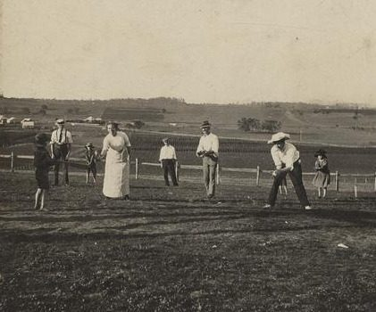

# Rounders

**Encyclopedia ID 761** (permanent) · https://bpupadhyaya.github.io/world-heritage-games-site/games/761-rounders/

*Photo: Shale, John F., [Public domain](https://creativecommons.org/publicdomain/mark/1.0/), [source on Wikimedia Commons](https://commons.wikimedia.org/wiki/File:Game_of_rounders_on_Christmas_Day_at_Baroona,_Glamorgan_Vale,_1913.jpg)*

Bat and ball.

## Heritage note

Part of the living heritage of Guyana.

## Origins

Usually placed in the era of Modern Heritage (1800 to today), although its exact origins are uncertain, within the cultural world of The Americas: Caribbean.

## Facts

- **Where:** Guyana
- **Type:** Street and playground games
- **Family:** Bat-and-ball games
- **Era:** [Modern Heritage](../../eras/modern/index.md) (uncertain)
- **Cradle:** [The Americas: Caribbean](../../cradles/caribbean/index.md)
- **Region:** Americas
- **Players:** 2 teams

## Related entries

- [Four Corners](../../games/652-four-corners/index.md)
- [Lapta](../../games/375-lapta/index.md)
- [Pesapallo](../../games/484-pesapallo/index.md)
- [Stoolball](../../games/492-stoolball/index.md)
- [Gilli-Danda](../../games/793-gilli-danda/index.md)
- [Baseball](../../games/22323-baseball/index.md)

## Sources

- <https://www.stabroeknews.com/2022/02/06/sunday/marble-games-and-buttons/>
