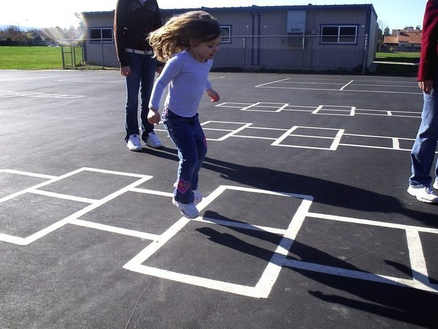

# Hopscotch

*Also known as: Marèl · Rayuela*

**Encyclopedia ID 762** (permanent) · https://bpupadhyaya.github.io/world-heritage-games-site/games/762-hopscotch/

*Photo: Dave Parker, [CC BY 2.0](https://creativecommons.org/licenses/by/2.0/), [source on Wikimedia Commons](https://commons.wikimedia.org/wiki/File:Hopscotch_in_California.jpg)*

Throw a flat stone into a chalked grid and hop through squares without touching the stone square.

## Heritage note

Part of the living heritage of Haiti, Honduras, Nicaragua.

## Origins

Usually placed in the era of Deep Past and First Games (before about 3000 BCE), although its exact origins are uncertain, within the cultural world of The Americas: Caribbean.

## Facts

- **Where:** Haiti, Honduras, Nicaragua, Panama, Guyana, Suriname, Argentina, Chile, Spain
- **Type:** Dexterity and skill games
- **Family:** Puzzle and dexterity toys
- **Era:** [Deep Past and First Games](../../eras/deep-past/index.md) (uncertain)
- **Cradle:** [The Americas: Caribbean](../../cradles/caribbean/index.md)
- **Region:** Americas
- **Players:** 2+

## Play it

[Try a 90-second preview in your browser](https://bpupadhyaya.github.io/games-site/games/rayuela-hop/play/) · [Google Play](https://play.google.com/store/apps/details?id=com.equalinformation.arcforge.shell) · [App Store](https://apps.apple.com/us/app/arcforge-world-heritage-games/id6813746442)

## Related entries

- [Street games](../../games/570-street-games/index.md)
- [Street](../../games/1052-street/index.md)
- [Pebbles](../../games/874-pebbles/index.md)
- [Diketo](../../games/1076-diketo/index.md)
- [Nhodo](../../games/1346-nhodo/index.md)
- [Seed throwing](../../games/612-seed-throwing/index.md)

## Sources

- <https://haitiantimes.com/2026/08/22/haiti-leogane-tradition/>
- <https://globalpressjournal.com/americas/haiti/haiti-caravan-tours-seek-revive-traditional-games-digital-age/fr/>
- <https://hondurassaber.com/juegos-tradicionales-de-honduras/>
- <https://www.vivanicaragua.com.ni/2016/05/05/deportes/13-juegos-tradicionales-ninos/>
