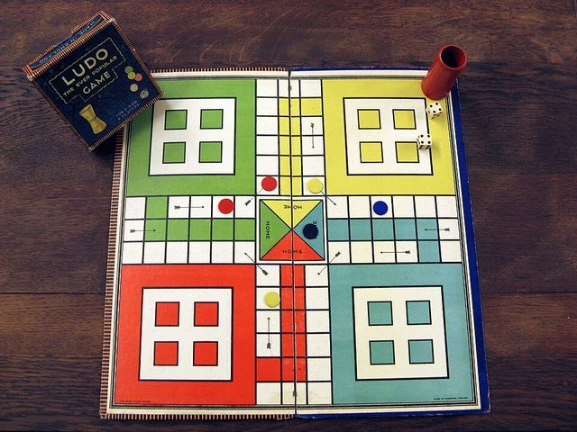

# Ludo

*Also known as: Lido*

**Encyclopedia ID 763** (permanent) · https://bpupadhyaya.github.io/world-heritage-games-site/games/763-ludo/

*Photo: Micha L. Rieser, Attribution, [source on Wikimedia Commons](https://commons.wikimedia.org/wiki/File:Ludo-3.jpg)*

Race four tokens round a cross-shaped track by dice throws, sending rivals home by landing on them; a simplified descendant of Pachisi.

## Heritage note

Part of the living heritage of Haiti, Jamaica, Cameroon.

## Origins

Usually placed in the era of River Valleys and First Cities (about 3000 to 1000 BCE), although its exact origins are uncertain, within the cultural world of The Americas: Caribbean.

## Facts

- **Where:** Haiti, Jamaica, Cameroon, Central African Republic, Chad, Angola
- **Type:** Board and table games
- **Family:** Race and cross games
- **Era:** [River Valleys and First Cities](../../eras/river-valleys/index.md) (uncertain)
- **Cradle:** [The Americas: Caribbean](../../cradles/caribbean/index.md)
- **Region:** Americas
- **Players:** 2-4

## Play it

[About the game](https://bpupadhyaya.github.io/games-site/games/pachisi-cowries-and-cross/) · [Google Play](https://play.google.com/store/apps/details?id=com.equalinformation.arcforge.shell) · [App Store](https://apps.apple.com/us/app/arcforge-world-heritage-games/id6813746442)

## Related entries

- [Nardi](../../games/551-nardi/index.md)
- [Tavli](../../games/656-tavli/index.md)
- [Senet](../../games/693-senet/index.md)
- [Don't Get Angry](../../games/744-dont-get-angry/index.md)
- [Royal Game of Ur](../../games/817-royal-game-of-ur/index.md)
- [Nard / backgammon](../../games/1168-nard-backgammon/index.md)

## Sources

- <https://haitiantimes.com/2026/08/22/haiti-leogane-tradition/>
- <https://www.jamrockmuseum.com/heritage/games-of-jamaica-from-street-corners-to-national-pride/>
- <https://connectingjamaica.com/history-and-how-to-play-jamaican-ludo-or-ludi/>
- <https://www.237online.com/a-quoi-jouaient-les-camerounais-autrefois-et-aujourdhui-et-ce-que-cela-revele-sur-levolution-sociale/>
