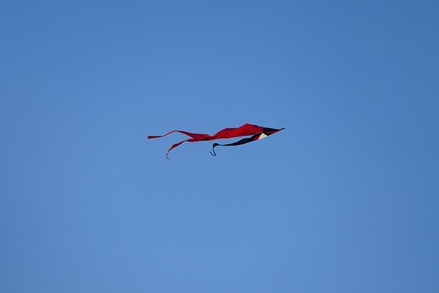

# Kite flying

*Also known as: Barrilete*

**Encyclopedia ID 769** (permanent) · https://bpupadhyaya.github.io/world-heritage-games-site/games/769-kite-flying/

*Photo: Kritzolina, [CC BY-SA 4.0](https://creativecommons.org/licenses/by-sa/4.0/), [source on Wikimedia Commons](https://commons.wikimedia.org/wiki/File:Kite_flying_over_Pasing_04.jpg)*

Fly homemade kites.

## Heritage note

Part of the living heritage of Honduras.

## Origins

Usually placed in the era of Classical Worlds (about 1000 BCE to 500 CE), although its exact origins are uncertain, within the cultural world of The Americas: Mesoamerica.

## Facts

- **Where:** Honduras
- **Type:** Dexterity and skill games
- **Family:** Tops, kites and spinning toys
- **Era:** [Classical Worlds](../../eras/classical/index.md) (uncertain)
- **Cradle:** [The Americas: Mesoamerica](../../cradles/meso-america/index.md)
- **Region:** Americas
- **Players:** 1-4

## Related entries

- [Kitendawili](../../games/181-kitendawili/index.md)
- [Kites](../../games/577-kites/index.md)
- [Wau bulan kite](../../games/911-wau-bulan-kite/index.md)
- [Kite fighting](../../games/788-kite-fighting/index.md)
- [Yo-yo](../../games/696-yo-yo/index.md)
- [Hoop Rolling Trundle](../../games/69-hoop-rolling-trundle/index.md)

## Sources

- <https://hondurassaber.com/juegos-tradicionales-de-honduras/>
