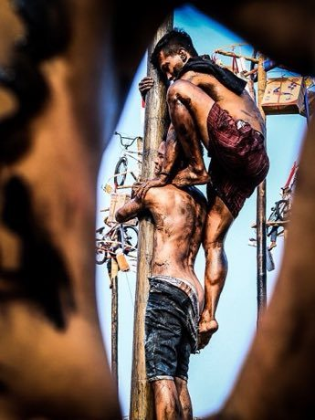

# Greasy pole climb

*Also known as: Panjat pinang*

**Encyclopedia ID 77** (permanent) · https://bpupadhyaya.github.io/world-heritage-games-site/games/77-greasy-pole-climb/

*Photo: Dhani ilham, [CC BY-SA 4.0](https://creativecommons.org/licenses/by-sa/4.0/), [source on Wikimedia Commons](https://commons.wikimedia.org/wiki/File:Panjat_Pinang_Indonesia.jpg)*

A team stacks and climbs a slippery pole to reach prizes at the top; balance members on shoulders, pick who goes up, and shake off grease to win.

## Heritage note

Part of the living heritage of Indonesia.

## Origins

A living tradition passed from person to person; it is not tied to a single dated origin. It belongs to the cultural world of Southeast Asia and the Islands.

## Facts

- **Where:** Indonesia
- **Type:** Performance and storytelling
- **Era:** [Living Traditions](../../eras/living/index.md)
- **Cradle:** [Southeast Asia and the Islands](../../cradles/southeast-asia/index.md)
- **Region:** East and Southeast Asia

## Related entries

- [Batik wax-resist pattern studio](../../games/105-batik-wax-resist-pattern-studio/index.md)
- [Angklung bamboo chime ensemble](../../games/142-angklung-bamboo-chime-ensemble/index.md)
- [Songket](../../games/320-songket/index.md)
- [Ketupat](../../games/322-ketupat/index.md)
- [Kendang](../../games/10163-kendang/index.md)
- [Prasi](../../games/15096-prasi/index.md)

## Sources

- <https://commons.wikimedia.org/wiki/File:Panjat_Pinang_Indonesia.jpg>
