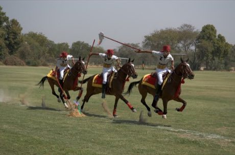

# Tent pegging

*Also known as: نیزہ بازی · neza bazi*

**Encyclopedia ID 78** (permanent) · https://bpupadhyaya.github.io/world-heritage-games-site/games/78-tent-pegging/

*Photo: Mike Bostock, [CC BY-SA 2.0](https://creativecommons.org/licenses/by-sa/2.0/), [source on Wikimedia Commons](https://commons.wikimedia.org/wiki/File:Tent_pegging_(montage).jpg)*

Tent pegging is a dexterity and skill game tradition from Pakistan, India.

## Heritage note

Part of the living heritage of Pakistan, India. Animals are partners in this tradition; good care and local rules always come first. It is presented as sport and skill, never as real fighting.

## Origins

Usually placed in the era of Modern Heritage (1800 to today), although its exact origins are uncertain, within the cultural world of South Asia.

## Facts

- **Where:** Pakistan, India
- **Type:** Dexterity and skill games
- **Family:** Winter sports
- **Era:** [Modern Heritage](../../eras/modern/index.md) (uncertain)
- **Cradle:** [South Asia](../../cradles/south-asia/index.md)
- **Region:** South and Central Asia

## Play it

[Try a 90-second preview in your browser](https://bpupadhyaya.github.io/games-site/games/tent-pegging/play/) · [Google Play](https://play.google.com/store/apps/details?id=com.equalinformation.arcforge.shell) · [App Store](https://apps.apple.com/us/app/arcforge-world-heritage-games/id6813746442)

## Related entries

- [Mallakhamb](../../games/150-mallakhamb/index.md)
- [Indian club swinging](../../games/264-indian-club-swinging/index.md)
- [Bhavai pot-balance dance](../../games/268-bhavai-pot-balance-dance/index.md)
- [Chinlone](../../games/16-chinlone/index.md)
- [Pinata swing](../../games/61-pinata-swing/index.md)
- [Ring Tilting](../../games/65-ring-tilting/index.md)

## Sources

- <https://commons.wikimedia.org/wiki/File:Tent_pegging_(montage).jpg>
