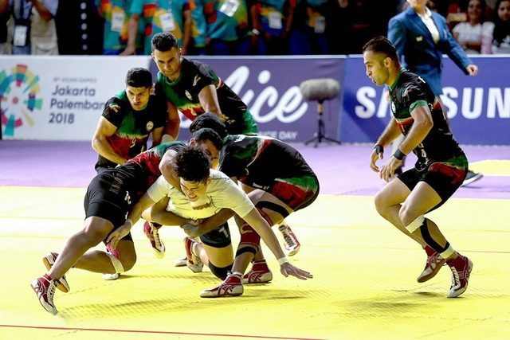

# Kabaddi

*Also known as: Hu-tu-tu · Chedugudu (South)*

**Encyclopedia ID 789** (permanent) · https://bpupadhyaya.github.io/world-heritage-games-site/games/789-kabaddi/

*Photo: Amir Hosseini, [CC BY 4.0](https://creativecommons.org/licenses/by/4.0/), [source on Wikimedia Commons](https://commons.wikimedia.org/wiki/File:Iran_men%27s_national_kabaddi_team_13970602000432636707284535394012_98208.jpg)*

A raider crosses into the other half, tags defenders and returns on one breath while chanting; teams of seven.

## Heritage note

Part of the living heritage of India, Pakistan, Bangladesh.

## Origins

Usually placed in the era of Modern Heritage (1800 to today), although its exact origins are uncertain, within the cultural world of South Asia.

## Facts

- **Where:** India, Pakistan, Bangladesh, Nepal
- **Type:** Street and playground games
- **Family:** Tag, chase and hide games
- **Era:** [Modern Heritage](../../eras/modern/index.md) (uncertain)
- **Cradle:** [South Asia](../../cradles/south-asia/index.md)
- **Region:** South and Central Asia
- **Players:** 2 teams of 7

## Play it

[Web preview](https://bpupadhyaya.github.io/games-site/games/kabaddi-raid-and-tag/) · [Google Play](https://play.google.com/store/apps/details?id=com.equalinformation.arcforge.shell) · [App Store](https://apps.apple.com/us/app/arcforge-world-heritage-games/id6813746442)

## Related entries

- [Kho-Kho](../../games/15-kho-kho/index.md)
- [Gollachut](../../games/573-gollachut/index.md)
- [Stick game](../../games/912-stick-game/index.md)
- [Bashi](../../games/915-bashi/index.md)
- [Cheese Rolling Hill](../../games/70-cheese-rolling-hill/index.md)
- [Otedama](../../games/131-otedama/index.md)

## Sources

- <https://www.prokabaddi.com/news/pro-kabaddi-league-season-10-viewership-continues-to-soar-on-star-sports-network>
- <https://en.wikipedia.org/wiki/Sport_in_India>
- <https://en.wikipedia.org/wiki/Traditional_games_of_India>
- <https://en.wikipedia.org/wiki/Traditional_games_of_Pakistan>
