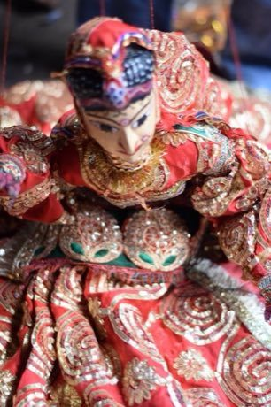

# Kathputli string puppets

*कठपुतली*

**Encyclopedia ID 79** (permanent) · https://equalinformation.com/world-heritage-games-site/games/79-kathputli-string-puppets/

*Photo: Manojmeena, [CC BY-SA 4.0](https://creativecommons.org/licenses/by-sa/4.0/), [source on Wikimedia Commons](https://commons.wikimedia.org/wiki/File:Kathputli_(Puppet)_of_Rajasthan.jpg)*

Pull string handles to make a puppet walk, bow and dance so it matches the music, then perform a short comedy scene for the crowd.

## Heritage note

Part of the living heritage of India. Some forms of this practice carry deep meaning for the communities who keep it; here we describe the play and the craft only, with respect for its roots.

## Origins

Usually placed in the era of Classical Worlds (about 1000 BCE to 500 CE), although its exact origins are uncertain, within the cultural world of South Asia.

## Facts

- **Where:** India
- **Type:** Performance and storytelling
- **Family:** String instruments
- **Era:** [Classical Worlds](../../eras/classical/index.md) (uncertain)
- **Cradle:** [South Asia](../../cradles/south-asia/index.md)
- **Region:** South and Central Asia

## Related entries

- [Murchunga](../../games/290-murchunga/index.md)
- [Morin khuur](../../games/34-morin-khuur/index.md)
- [Valiha tube zither](../../games/124-valiha-tube-zither/index.md)
- [Krar lyre](../../games/126-krar-lyre/index.md)
- [Joropo llanero band](../../games/130-joropo-llanero-band/index.md)
- [Kanklės](../../games/136-kankles/index.md)

## Sources

- <https://commons.wikimedia.org/wiki/File:Kathputli_(Puppet)_of_Rajasthan.jpg>
