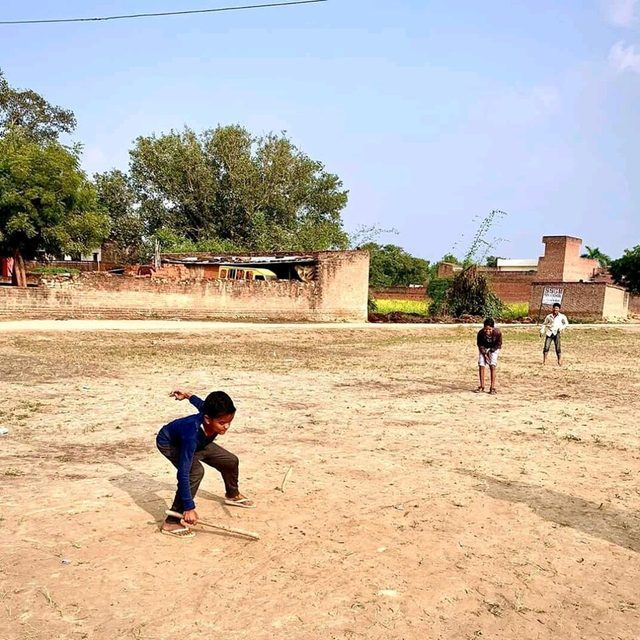

# Gilli-Danda

*Also known as: Gulli Danda*

**Encyclopedia ID 793** (permanent) · https://bpupadhyaya.github.io/world-heritage-games-site/games/793-gilli-danda/

*Photo: Srvyadav, [CC BY-SA 4.0](https://creativecommons.org/licenses/by-sa/4.0/), [source on Wikimedia Commons](https://commons.wikimedia.org/wiki/File:Jgp_gilli_danda.jpg)*

Strike a small tapered stick with a larger one, then hit it far and avoid it being caught.

## Heritage note

Part of the living heritage of India.

## Origins

Usually placed in the era of Modern Heritage (1800 to today), although its exact origins are uncertain, within the cultural world of South Asia.

## Facts

- **Where:** India
- **Type:** Dexterity and skill games
- **Family:** Bat-and-ball games
- **Era:** [Modern Heritage](../../eras/modern/index.md) (uncertain)
- **Cradle:** [South Asia](../../cradles/south-asia/index.md)
- **Region:** South and Central Asia
- **Players:** 2+

## Play it

[Web preview](https://bpupadhyaya.github.io/games-site/games/gilli-danda-stick-and-peg/play/) · [Google Play](https://play.google.com/store/apps/details?id=com.equalinformation.arcforge.shell) · [App Store](https://apps.apple.com/us/app/arcforge-world-heritage-games/id6813746442)

## Related entries

- [Lapta](../../games/375-lapta/index.md)
- [Pesapallo](../../games/484-pesapallo/index.md)
- [Stoolball](../../games/492-stoolball/index.md)
- [Four Corners](../../games/652-four-corners/index.md)
- [Rounders](../../games/761-rounders/index.md)
- [Vitti Dandu](../../games/9804-vitti-dandu/index.md)

## Sources

- <https://en.wikipedia.org/wiki/Sport_in_India>
- <https://en.wikipedia.org/wiki/Traditional_games_of_Pakistan>
