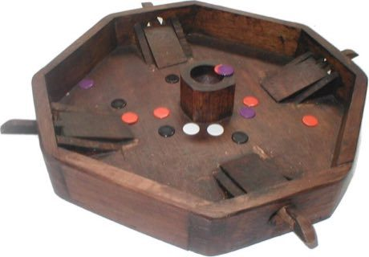

# Disc-flip

*Also known as: Tiddlywinks*

**Encyclopedia ID 8** (permanent) · https://bpupadhyaya.github.io/world-heritage-games-site/games/8-disc-flip/

*Photo: Cyrille BERNIZET (flea game, French variant photo), [CC BY-SA 3.0](https://creativecommons.org/licenses/by-sa/3.0/), [source on Wikimedia Commons](https://commons.wikimedia.org/wiki/File:Jeu_puces.jpg)*

Press a large disc (squidger) on the edge of small discs to flip them into a pot or on top of an opponent's pieces (squopping).

## Heritage note

Part of the living heritage of United Kingdom.

## Origins

Usually placed in the era of Modern Heritage (1800 to today), although its exact origins are uncertain, within the cultural world of Celtic and Atlantic Europe.

## Facts

- **Where:** United Kingdom
- **Type:** Dexterity and skill games
- **Family:** Puzzle and dexterity toys
- **Era:** [Modern Heritage](../../eras/modern/index.md) (uncertain)
- **Cradle:** [Celtic and Atlantic Europe](../../cradles/celtic-atlantic/index.md)
- **Region:** Europe

## Play it

[Web preview](https://bpupadhyaya.github.io/) · [Google Play](https://play.google.com/store/apps/details?id=com.equalinformation.arcforge.shell) · [App Store](https://apps.apple.com/us/app/arcforge-world-heritage-games/id6813746442)

## Related entries

- [Shove ha'penny](../../games/54-shove-hapenny/index.md)
- [Cynghanedd Poetry Puzzle](../../games/1448-cynghanedd-poetry-puzzle/index.md)
- [Crossword](../../games/22326-crossword/index.md)
- [Sjoelen](../../games/9-sjoelen/index.md)
- [Diabolo](../../games/5023-diabolo/index.md)
- [Pitch and toss](../../games/822-pitch-and-toss/index.md)

## Sources

- <https://commons.wikimedia.org/wiki/File:Jeu_puces.jpg>
