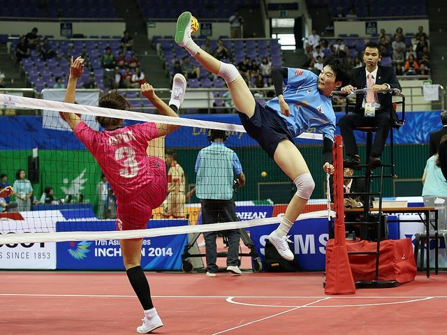

# Sepak takraw

**Encyclopedia ID 802** (permanent) · https://bpupadhyaya.github.io/world-heritage-games-site/games/802-sepak-takraw/

*Photo: Republic of Korea from Seoul, Republic of Korea, [CC BY-SA 2.0](https://creativecommons.org/licenses/by-sa/2.0/), [source on Wikimedia Commons](https://commons.wikimedia.org/wiki/File:Incheon_AsianGames_Sepaktakraw_09_(15291705581).jpg)*

Circle or net game with a rattan ball played with feet and head; Malacca origins cited around the 15th century.

## Heritage note

Part of the living heritage of Indonesia, Malaysia, Brunei.

## Origins

Usually placed in the era of Modern Heritage (1800 to today), although its exact origins are uncertain, within the cultural world of Southeast Asia and the Islands.

## Facts

- **Where:** Indonesia, Malaysia, Brunei, Thailand
- **Type:** Street and playground games
- **Family:** Kicking and football games
- **Era:** [Modern Heritage](../../eras/modern/index.md) (uncertain)
- **Cradle:** [Southeast Asia and the Islands](../../cradles/southeast-asia/index.md)
- **Region:** East and Southeast Asia
- **Players:** 6

## Play it

[Try a 90-second preview in your browser](https://bpupadhyaya.github.io/games-site/games/sepak-takraw-rally/play/) · [Google Play](https://play.google.com/store/apps/details?id=com.equalinformation.arcforge.shell) · [App Store](https://apps.apple.com/us/app/arcforge-world-heritage-games/id6813746442)

## Related entries

- [Chapteh shuttlecock](../../games/1066-chapteh-shuttlecock/index.md)
- [Jianzi](../../games/1-jianzi/index.md)
- [Nohejbal](../../games/378-nohejbal/index.md)
- [Peteca](../../games/421-peteca/index.md)
- [Rugby football](../../games/3686-rugby-football/index.md)
- [Traditional football](../../games/10068-traditional-football/index.md)

## Sources

- <https://en.wikipedia.org/wiki/Sport_in_Indonesia>
- <https://en.wikipedia.org/wiki/Sepak_takraw>
- <https://heritage.gov.my/en/pengenalan-cawangan-adat-budaya/permainan-tradisi.html>
- <https://en.wikipedia.org/wiki/Sport_in_Brunei>
