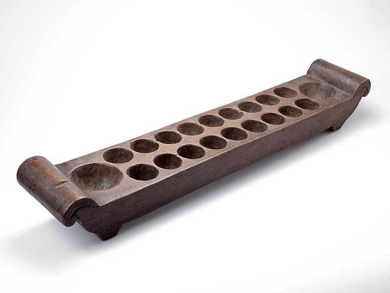

# Congklak

*Also known as: Congklak (Dakon) · Dakon · Congkak*

**Encyclopedia ID 803** (permanent) · https://bpupadhyaya.github.io/world-heritage-games-site/games/803-congklak/

*Photo: Tropenmuseum, [CC BY-SA 3.0](https://creativecommons.org/licenses/by-sa/3.0/), [source on Wikimedia Commons](https://commons.wikimedia.org/wiki/File:COLLECTIE_TROPENMUSEUM_Speelbord_voor_mancala_spel_TMnr_1585-120a.jpg)*

Malay mancala board with 14 houses and 2 stores, played with shells; considered the Malay member of the mancala family.

## How it is played

Malay mancala board with 14 houses and 2 stores, played with shells; considered the Malay member of the mancala family. Wikipedia notes it was featured on Malaysia's second-series 10 sen coin.

## Heritage note

Part of the living heritage of Indonesia, Malaysia, Brunei.

## Origins

Usually placed in the era of Deep Past and First Games (before about 3000 BCE), although its exact origins are uncertain, within the cultural world of Southeast Asia and the Islands.

## Facts

- **Where:** Indonesia, Malaysia, Brunei
- **Type:** Board and table games
- **Family:** Mancala and sowing games
- **Era:** [Deep Past and First Games](../../eras/deep-past/index.md) (uncertain)
- **Cradle:** [Southeast Asia and the Islands](../../cradles/southeast-asia/index.md)
- **Region:** East and Southeast Asia
- **Players:** 2

## Play it

[Web preview](https://bpupadhyaya.github.io/games-site/games/congklak-sungka-shells/play/) · [Google Play](https://play.google.com/store/apps/details?id=com.equalinformation.arcforge.shell) · [App Store](https://apps.apple.com/us/app/arcforge-world-heritage-games/id6813746442)

## Related entries

- [Mandarin square capturing](../../games/1216-mandarin-square-capturing/index.md)
- [Sungka](../../games/1025-sungka/index.md)
- [Songo](../../games/617-songo/index.md)
- [Bao](../../games/647-bao/index.md)
- [Kisolo](../../games/666-kisolo/index.md)
- [Oware](../../games/749-oware/index.md)

## Sources

- <https://en.wikipedia.org/wiki/Traditional_games_in_Indonesia>
- <https://heritage.gov.my/en/pengenalan-cawangan-adat-budaya/permainan-tradisi.html>
- <https://en.wikipedia.org/wiki/Congkak>
- <https://malaysiafact.com/malaysia-traditional-games/>
