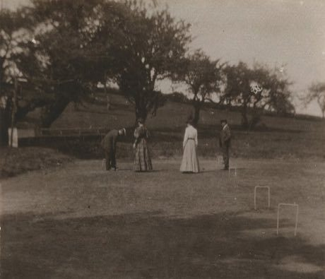

# Croquet

*Also known as: Jeu de mail*

**Encyclopedia ID 81** (permanent) · https://bpupadhyaya.github.io/world-heritage-games-site/games/81-croquet/

*Photo: UBC Library Digitization Centre, No restrictions, [source on Wikimedia Commons](https://commons.wikimedia.org/wiki/Photograph_depicting_men_and_women_playing_croquet_(14887617817).jpg)*

Strike balls with a mallet through hoops in order, using roquet and croquet shots to send opponents' balls away.

## Heritage note

Part of the living heritage of United Kingdom, Ireland, France.

## Origins

Usually placed in the era of Crossroads and Golden Ages (about 500 to 1500), although its exact origins are uncertain, within the cultural world of Celtic and Atlantic Europe.

## Facts

- **Where:** United Kingdom, Ireland, France
- **Type:** Board and table games
- **Era:** [Crossroads and Golden Ages](../../eras/crossroads/index.md) (uncertain)
- **Cradle:** [Celtic and Atlantic Europe](../../cradles/celtic-atlantic/index.md)
- **Region:** Europe

## Related entries

- [Water Jousting](../../games/393-water-jousting/index.md)
- [Racing Pigeon Loft](../../games/411-racing-pigeon-loft/index.md)
- [Highland Bagpipe Chanter and Drone](../../games/510-highland-bagpipe-chanter-and-drone/index.md)
- [Hurling](../../games/821-hurling/index.md)
- [Pub dominoes](../../games/1183-pub-dominoes/index.md)
- [Reversi](../../games/22336-reversi/index.md)

## Sources

- <https://commons.wikimedia.org/wiki/Photograph_depicting_men_and_women_playing_croquet_(14887617817).jpg>
