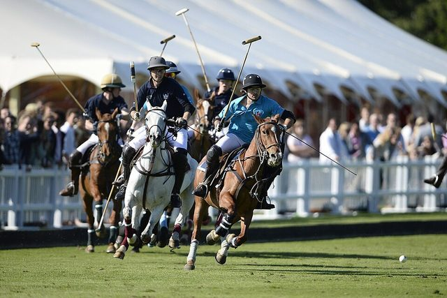

# Chogan

*Also known as: Chovgan · Persian polo*

**Encyclopedia ID 810** (permanent) · https://bpupadhyaya.github.io/world-heritage-games-site/games/810-chogan/

*Photo: Andreas Polo, [CC BY-SA 3.0](https://creativecommons.org/licenses/by-sa/3.0/), [source on Wikimedia Commons](https://commons.wikimedia.org/wiki/File:Varsity_Polo_2013.jpg)*

Ancient horseback ball-and-mallet game from Iran, ancestor of polo.

## Heritage note

Part of the living heritage of Iran.

## Origins

Usually placed in the era of Classical Worlds (about 1000 BCE to 500 CE), although its exact origins are uncertain, within the cultural world of Persia, Caucasus and Central Asia.

## Facts

- **Where:** Iran
- **Type:** Street and playground games
- **Family:** Stick-and-ball games
- **Era:** [Classical Worlds](../../eras/classical/index.md) (uncertain)
- **Cradle:** [Persia, Caucasus and Central Asia](../../cradles/persia-central-asia/index.md)
- **Region:** Middle East and North Africa
- **Players:** Teams

## Play it

[About the game](https://bpupadhyaya.github.io/games-site/games/chogan-persian-polo/) · [Google Play](https://play.google.com/store/apps/details?id=com.equalinformation.arcforge.shell) · [App Store](https://apps.apple.com/us/app/arcforge-world-heritage-games/id6813746442)

## Related entries

- [Chovqan](../../games/565-chovqan/index.md)
- [Chavgonbozi](../../games/1132-chavgonbozi/index.md)
- [Kok-boru](../../games/241-kok-boru/index.md)
- [Hurling](../../games/821-hurling/index.md)
- [Rope pulling](../../games/855-rope-pulling/index.md)
- [Kyz Kuu](../../games/858-kyz-kuu/index.md)

## Sources

- <https://en.wikipedia.org/wiki/Traditional_games_of_Iran>
