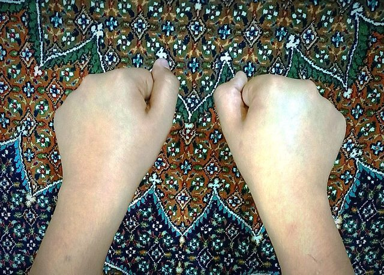

# Flower or Empty

*Also known as: Gol ya pooch · Gol ya Pouch · hidden-object guessing*

**Encyclopedia ID 812** (permanent) · https://bpupadhyaya.github.io/world-heritage-games-site/games/812-flower-or-empty/

*Photo: Amir sibil, [CC BY-SA 4.0](https://creativecommons.org/licenses/by-sa/4.0/), [source on Wikimedia Commons](https://commons.wikimedia.org/wiki/File:Gol_ya_Pooch_Game_Ready_Fists_Iran.jpg)*

Teams hide a small object in a fist while the other team guesses; similar to Mheibes.

## Heritage note

Part of the living heritage of Iran.

## Origins

Usually placed in the era of Modern Heritage (1800 to today), although its exact origins are uncertain, within the cultural world of Persia, Caucasus and Central Asia.

## Facts

- **Where:** Iran
- **Type:** Street and playground games
- **Era:** [Modern Heritage](../../eras/modern/index.md) (uncertain)
- **Cradle:** [Persia, Caucasus and Central Asia](../../cradles/persia-central-asia/index.md)
- **Region:** Middle East and North Africa
- **Players:** 8+ (two teams)

## Related entries

- [Qanat Water Tunnels](../../games/160-qanat-water-tunnels/index.md)
- [Zurkhaneh strength rhythm](../../games/227-zurkhaneh-strength-rhythm/index.md)
- [Astrolabe: reading the sky](../../games/236-astrolabe-reading-the-sky/index.md)
- [Lelo Burti](../../games/737-lelo-burti/index.md)
- [Asyk Atu](../../games/856-asyk-atu/index.md)
- [White Cloth](../../games/867-white-cloth/index.md)

## Sources

- <https://en.wikipedia.org/wiki/Gol_ya_pooch>
