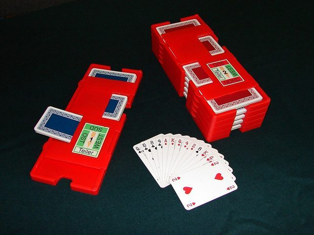

# Tarneeb

*Also known as: Tarnib*

**Encyclopedia ID 816** (permanent) · https://bpupadhyaya.github.io/world-heritage-games-site/games/816-tarneeb/

*Photo: Klaus Köpplinger ( koeppiK ), [CC BY 2.5](https://creativecommons.org/licenses/by/2.5/), [source on Wikimedia Commons](https://commons.wikimedia.org/wiki/File:Bridge_boards_box.jpg)*

Four players in two teams bid for the right to name trumps, then must take at least their bid in tricks.

## Heritage note

Part of the living heritage of Iraq, Syria, Lebanon.

## Origins

Usually placed in the era of Age of Contact and Craft (about 1500 to 1800), although its exact origins are uncertain, within the cultural world of Mesopotamia, Levant and Arabia.

## Facts

- **Where:** Iraq, Syria, Lebanon, Jordan, Palestine, Egypt
- **Type:** Card games
- **Era:** [Age of Contact and Craft](../../eras/contact/index.md) (uncertain)
- **Cradle:** [Mesopotamia, Levant and Arabia](../../cradles/mesopotamia-levant/index.md)
- **Region:** Middle East and North Africa
- **Players:** 4

## Play it

[Web preview](https://bpupadhyaya.github.io/games-site/games/tarneeb-levant-table/) · [Google Play](https://play.google.com/store/apps/details?id=com.equalinformation.arcforge.shell) · [App Store](https://apps.apple.com/us/app/arcforge-world-heritage-games/id6813746442)

## Related entries

- [Baloot](../../games/1060-baloot/index.md)
- [Traditional dhow sail racing](../../games/6768-traditional-dhow-sail-racing/index.md)
- [Camel racing dash](../../games/19-camel-racing-dash/index.md)
- [Dabke line dance](../../games/37-dabke-line-dance/index.md)
- [Turkish Dama](../../games/155-turkish-dama/index.md)
- [Mheibes](../../games/158-mheibes/index.md)

## Sources

- <https://en.wikipedia.org/wiki/Tarneeb>
- <https://kaleela.com/en/blog/deal-me-in-arab-card-games/>
- <https://sandramajed.substack.com/p/world-of-arab-history-what-traditional>
- <https://www.pagat.com/national/egypt.html>
