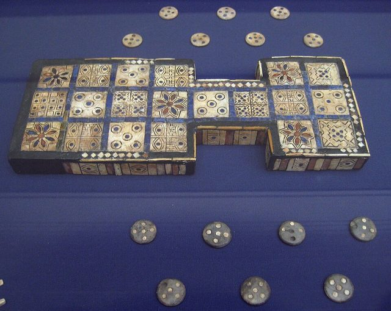

# Royal Game of Ur

**Encyclopedia ID 817** (permanent) · https://bpupadhyaya.github.io/world-heritage-games-site/games/817-royal-game-of-ur/

*Photo: Unknown author (public domain), [CC0](https://creativecommons.org/publicdomain/zero/1.0/), [source on Wikimedia Commons](https://commons.wikimedia.org/wiki/File:British_Museum_Royal_Game_of_Ur.jpg)*

Ancient Mesopotamian race game revived from tablets.

## Heritage note

Part of the living heritage of Iraq.

## Origins

Usually placed in the era of River Valleys and First Cities (about 3000 to 1000 BCE), although its exact origins are uncertain, within the cultural world of Mesopotamia, Levant and Arabia.

## Facts

- **Where:** Iraq
- **Type:** Board and table games
- **Family:** Race and cross games
- **Era:** [River Valleys and First Cities](../../eras/river-valleys/index.md) (uncertain)
- **Cradle:** [Mesopotamia, Levant and Arabia](../../cradles/mesopotamia-levant/index.md)
- **Region:** Middle East and North Africa
- **Players:** 2

## Play it

[Web preview](https://bpupadhyaya.github.io/games-site/games/royal-game-of-ur-race/play/) · [Google Play](https://play.google.com/store/apps/details?id=com.equalinformation.arcforge.shell) · [App Store](https://apps.apple.com/us/app/arcforge-world-heritage-games/id6813746442)

## Related entries

- [Tawla](../../games/815-tawla/index.md)
- [Tawle](../../games/880-tawle/index.md)
- [Backgammon](../../games/1159-backgammon/index.md)
- [Nardi](../../games/551-nardi/index.md)
- [Tavli](../../games/656-tavli/index.md)
- [Senet](../../games/693-senet/index.md)

## Sources

- <https://sandramajed.substack.com/p/world-of-arab-history-what-traditional>
