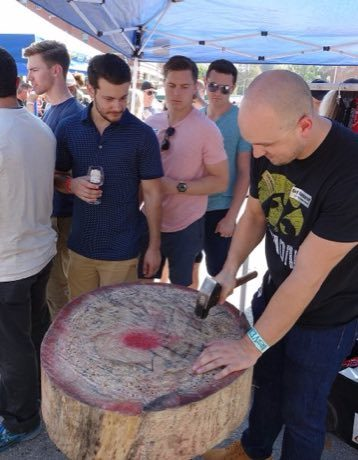

# Nail driving

*Hammerschlagen · Hammerschlagen / Wettnageln*

**Encyclopedia ID 82** (permanent) · https://bpupadhyaya.github.io/world-heritage-games-site/games/82-nail-driving/

*Photo: Alan Light, [CC BY 2.0](https://creativecommons.org/licenses/by/2.0/), [source on Wikimedia Commons](https://commons.wikimedia.org/wiki/Hammerschlagen_Oktoberfest_2016.jpg)*

Take turns hitting the nail into a stump with the narrow end of a hammer; the one who sinks their nail first wins, a bent nail loses.

## Heritage note

Part of the living heritage of Germany.

## Origins

Usually placed in the era of Modern Heritage (1800 to today), although its exact origins are uncertain, within the cultural world of Northern and Eastern Europe.

## Facts

- **Where:** Germany
- **Type:** Dexterity and skill games
- **Family:** Puzzle and dexterity toys
- **Era:** [Modern Heritage](../../eras/modern/index.md) (uncertain)
- **Cradle:** [Northern and Eastern Europe](../../cradles/north-east-europe/index.md)
- **Region:** Europe

## Related entries

- [Clockwork Movement Builder](../../games/502-clockwork-movement-builder/index.md)
- [Kiiking](../../games/66-kiiking/index.md)
- [Ringridning](../../games/1365-ringridning/index.md)
- [Kingyo-sukui](../../games/3-kingyo-sukui/index.md)
- [Stone Skipping](../../games/5-stone-skipping/index.md)
- [Disc-flip](../../games/8-disc-flip/index.md)

## Sources

- <https://commons.wikimedia.org/wiki/Hammerschlagen_Oktoberfest_2016.jpg>
