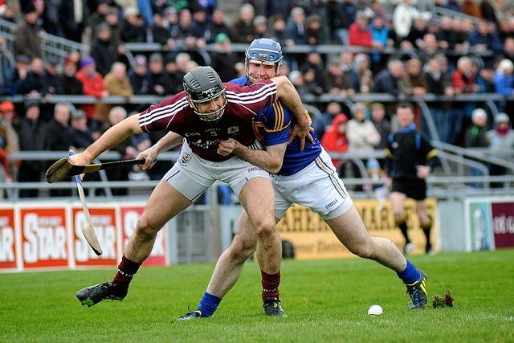

# Hurling

*Also known as: Iomáint · Camogie*

**Encyclopedia ID 821** (permanent) · https://bpupadhyaya.github.io/world-heritage-games-site/games/821-hurling/

*Photo: Seaninryan, [CC BY-SA 3.0](https://creativecommons.org/licenses/by-sa/3.0/), [source on Wikimedia Commons](https://commons.wikimedia.org/wiki/File:David_Collins_and_Eoin_Kelly_(Tipperary).jpg)*

Fast stick-and-ball field game, one of the oldest field games in Europe; GAA national sport.

## Heritage note

Part of the living heritage of Ireland.

## Origins

Usually placed in the era of Crossroads and Golden Ages (about 500 to 1500), although its exact origins are uncertain, within the cultural world of Celtic and Atlantic Europe.

## Facts

- **Where:** Ireland
- **Type:** Street and playground games
- **Family:** Stick-and-ball games
- **Era:** [Crossroads and Golden Ages](../../eras/crossroads/index.md) (uncertain)
- **Cradle:** [Celtic and Atlantic Europe](../../cradles/celtic-atlantic/index.md)
- **Region:** Europe
- **Players:** 15 a side

## Play it

[Web preview](https://bpupadhyaya.github.io/games-site/games/hurling-sliotar-dash/) · [Google Play](https://play.google.com/store/apps/details?id=com.equalinformation.arcforge.shell) · [App Store](https://apps.apple.com/us/app/arcforge-world-heritage-games/id6813746442)

## Related entries

- [Croquet](../../games/81-croquet/index.md)
- [Water Jousting](../../games/393-water-jousting/index.md)
- [Racing Pigeon Loft](../../games/411-racing-pigeon-loft/index.md)
- [Highland Bagpipe Chanter and Drone](../../games/510-highland-bagpipe-chanter-and-drone/index.md)
- [Shinny](../../games/725-shinny/index.md)
- [Chogan](../../games/810-chogan/index.md)
