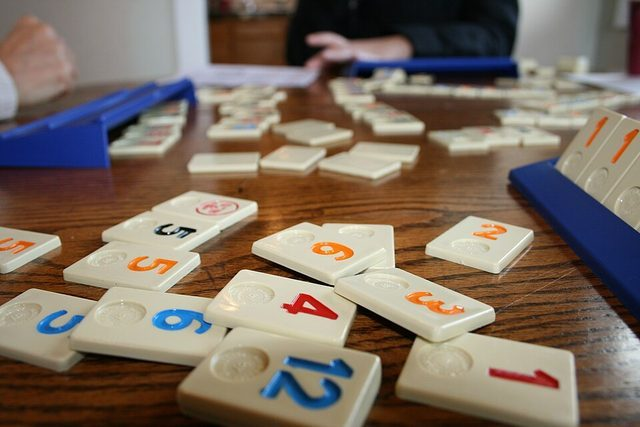

# Rummikub

**Encyclopedia ID 826** (permanent) · https://bpupadhyaya.github.io/world-heritage-games-site/games/826-rummikub/

*Photo: ryan harvey, [CC BY-SA 2.0](https://creativecommons.org/licenses/by-sa/2.0/), [source on Wikimedia Commons](https://commons.wikimedia.org/wiki/File:Rummikub_Tiles.jpg)*

Tile rummy invented by Ephraim Hertzano.

## Heritage note

Part of the living heritage of Israel.

## Origins

Usually placed in the era of Crossroads and Golden Ages (about 500 to 1500), although its exact origins are uncertain, within the cultural world of Mesopotamia, Levant and Arabia.

## Facts

- **Where:** Israel
- **Type:** Board and table games
- **Family:** Dominoes and tile games
- **Era:** [Crossroads and Golden Ages](../../eras/crossroads/index.md) (uncertain)
- **Cradle:** [Mesopotamia, Levant and Arabia](../../cradles/mesopotamia-levant/index.md)
- **Region:** Middle East and North Africa
- **Players:** 2-4

## Related entries

- [101 Okey](../../games/1166-101-okey/index.md)
- [Mahjong](../../games/635-mahjong/index.md)
- [Cafe dominoes](../../games/690-cafe-dominoes/index.md)
- [Riichi mahjong](../../games/851-riichi-mahjong/index.md)
- [Chickenfoot](../../games/1193-chickenfoot/index.md)
- [Texas 42](../../games/1195-texas-42/index.md)

## Sources

- <https://en.wikipedia.org/wiki/Rummikub>
