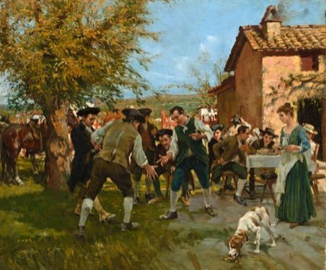

# Morra

*Morra / mora*

**Encyclopedia ID 83** (permanent) · https://equalinformation.com/world-heritage-games-site/games/83-morra/

*Photo: Raffaello Sorbi, [Public domain](https://creativecommons.org/publicdomain/mark/1.0/), [source on Wikimedia Commons](https://commons.wikimedia.org/wiki/The_game_of_morra_(unknown_date),_by_Raffaello_Sorbi.jpg)*

Both players flash 1 to 5 fingers and shout a guess of the total; the exact guess scores a point, first to a target wins.

## Heritage note

Part of the living heritage of Italy.

## Origins

Usually placed in the era of Classical Worlds (about 1000 BCE to 500 CE), although its exact origins are uncertain, within the cultural world of Mediterranean.

## Facts

- **Where:** Italy
- **Type:** Archery, throwing and target games
- **Family:** Rhyme and hand games
- **Era:** [Classical Worlds](../../eras/classical/index.md) (uncertain)
- **Cradle:** [Mediterranean](../../cradles/mediterranean/index.md)
- **Region:** Europe

## Related entries

- [Tuvan Throat Singing](../../games/508-tuvan-throat-singing/index.md)
- [Finger Hooking](../../games/1452-finger-hooking/index.md)
- [Sicilian Puppet Knights](../../games/514-sicilian-puppet-knights/index.md)
- [Double Dutch](../../games/53-double-dutch/index.md)
- [Tbourida](../../games/164-tbourida/index.md)
- [Cublak-cublak suweng](../../games/325-cublak-cublak-suweng/index.md)

## Sources

- <https://commons.wikimedia.org/wiki/The_game_of_morra_(unknown_date),_by_Raffaello_Sorbi.jpg>
