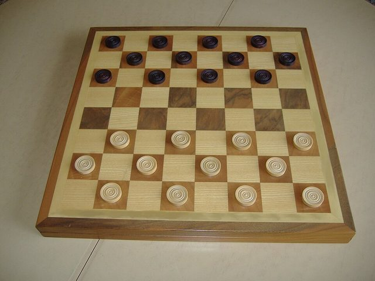

# Italian draughts

*Also known as: Dama italiana*

**Encyclopedia ID 834** (permanent) · https://bpupadhyaya.github.io/world-heritage-games-site/games/834-italian-draughts/

*Photo: No machine-readable author provided. Jatroce~commonswiki assumed (based on copyright claims)., [CC BY-SA 3.0](https://creativecommons.org/licenses/by-sa/3.0/), [source on Wikimedia Commons](https://commons.wikimedia.org/wiki/File:Damiera.JPG)*

8x8 draughts where men cannot capture kings; played in clubs with a federation.

## Heritage note

Part of the living heritage of Italy.

## Origins

Usually placed in the era of Crossroads and Golden Ages (about 500 to 1500), although its exact origins are uncertain, within the cultural world of Mediterranean.

## Facts

- **Where:** Italy
- **Type:** Board and table games
- **Family:** Draughts and capture games
- **Era:** [Crossroads and Golden Ages](../../eras/crossroads/index.md) (uncertain)
- **Cradle:** [Mediterranean](../../cradles/mediterranean/index.md)
- **Region:** Europe
- **Players:** 2

## Related entries

- [Kharbaga](../../games/459-kharbaga/index.md)
- [Zamma](../../games/462-zamma/index.md)
- [Turkish Dama](../../games/155-turkish-dama/index.md)
- [Yote Capture Grid](../../games/167-yote-capture-grid/index.md)
- [Peralikatuma](../../games/287-peralikatuma/index.md)
- [Sholo Guti](../../games/461-sholo-guti/index.md)
