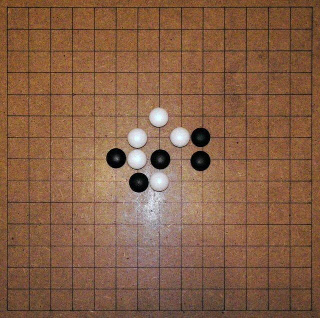

# Gomoku and Renju

*Also known as: 五目並べ Gomoku · 連珠 Renju · Five in a row*

**Encyclopedia ID 847** (permanent) · https://bpupadhyaya.github.io/world-heritage-games-site/games/847-gomoku-and-renju/

*Photo: Matěj Baťha, [CC BY 2.5](https://creativecommons.org/licenses/by/2.5/), [source on Wikimedia Commons](https://commons.wikimedia.org/wiki/File:Renju.jpg)*

Players alternate placing stones to get five in a row; Renju adds restrictions on the first player to keep balance.

## Heritage note

Part of the living heritage of Japan.

## Origins

Usually placed in the era of Crossroads and Golden Ages (about 500 to 1500), although its exact origins are uncertain, within the cultural world of Japan and Korea.

## Facts

- **Where:** Japan
- **Type:** Board and table games
- **Family:** Alignment and connection games
- **Era:** [Crossroads and Golden Ages](../../eras/crossroads/index.md) (uncertain)
- **Cradle:** [Japan and Korea](../../cradles/japan-korea/index.md)
- **Region:** East and Southeast Asia
- **Players:** 2

## Play it

[Try a 90-second preview in your browser](https://bpupadhyaya.github.io/games-site/games/renju-omok-five-row/play/) · [Google Play](https://play.google.com/store/apps/details?id=com.equalinformation.arcforge.shell) · [App Store](https://apps.apple.com/us/app/arcforge-world-heritage-games/id6813746442)

## Related entries

- [Duo](../../games/838-duo/index.md)
- [Shisima](../../games/865-shisima/index.md)
- [Fanoron-Telo](../../games/902-fanoron-telo/index.md)
- [Hasami shogi](../../games/849-hasami-shogi/index.md)
- [Riichi mahjong](../../games/851-riichi-mahjong/index.md)
- [Shogi](../../games/852-shogi/index.md)

## Sources

- <https://en.wikipedia.org/wiki/Gomoku>
