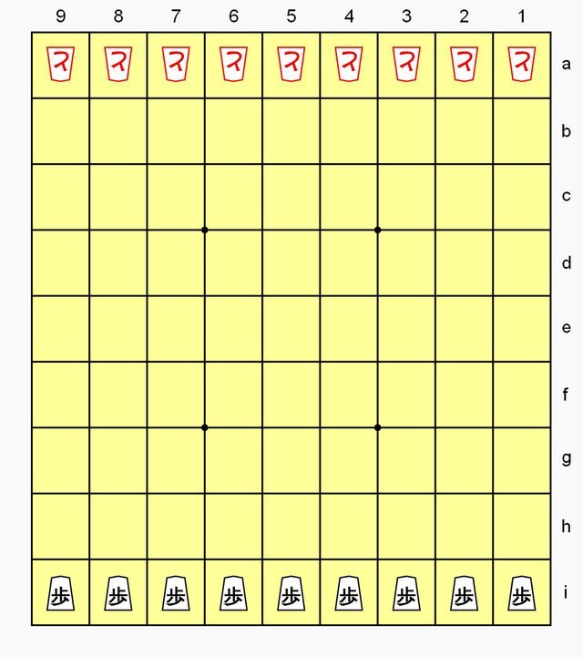

# Hasami shogi

**Encyclopedia ID 849** (permanent) · https://bpupadhyaya.github.io/world-heritage-games-site/games/849-hasami-shogi/

*Photo: Ihardlythinkso, [CC0](https://creativecommons.org/publicdomain/zero/1.0/), [source on Wikimedia Commons](https://commons.wikimedia.org/wiki/File:Hasami_Shogi_9x9_init_config.png)*

Single-type pieces move like rooks and capture by sandwiching an enemy piece between two of your own.

## Heritage note

Part of the living heritage of Japan.

## Origins

Usually placed in the era of Crossroads and Golden Ages (about 500 to 1500), although its exact origins are uncertain, within the cultural world of Japan and Korea.

## Facts

- **Where:** Japan
- **Type:** Board and table games
- **Family:** Chess family
- **Era:** [Crossroads and Golden Ages](../../eras/crossroads/index.md) (uncertain)
- **Cradle:** [Japan and Korea](../../cradles/japan-korea/index.md)
- **Region:** East and Southeast Asia
- **Players:** 2

## Play it

[Try a 90-second preview in your browser](https://bpupadhyaya.github.io/games-site/games/hasami-shogi-pairs/play/) · [Google Play](https://play.google.com/store/apps/details?id=com.equalinformation.arcforge.shell) · [App Store](https://apps.apple.com/us/app/arcforge-world-heritage-games/id6813746442)

## Related entries

- [Shogi](../../games/852-shogi/index.md)
- [Janggi](../../games/1081-janggi/index.md)
- [Chaturanga](../../games/45-chaturanga/index.md)
- [Sittuyin](../../games/302-sittuyin/index.md)
- [Chess](../../games/552-chess/index.md)
- [Luzhanqi](../../games/640-luzhanqi/index.md)

## Sources

- <https://en.wikipedia.org/wiki/Hasami_shogi>
