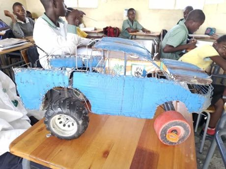

# Wire car

*Also known as: Galimoto (Chichewa) · wire-car · street-made toy car*

**Encyclopedia ID 85** (permanent) · https://bpupadhyaya.github.io/world-heritage-games-site/games/85-wire-car/

*Photo: Gwasheya, [CC0](https://creativecommons.org/publicdomain/zero/1.0/), [source on Wikimedia Commons](https://commons.wikimedia.org/wiki/File:Wire_car.jpg)*

Bend and bind a car from wire and scrap, pick wheels and a steering stick, then drive it along a dusty street track around obstacles.

## Heritage note

A tradition shared by communities in many places.

## Origins

A living tradition passed from person to person; it is not tied to a single dated origin.

## Facts

- **Where:** Shared across many places
- **Type:** Crafts and making
- **Family:** Winter sports
- **Era:** [Living Traditions](../../eras/living/index.md)
- **Cradle:** [Shared across the world](../../cradles/worldwide/index.md)
- **Region:** Sub-Saharan Africa

## Related entries

- [Bamboo scaffold builder](../../games/369-bamboo-scaffold-builder/index.md)
- [Neon sign bender](../../games/371-neon-sign-bender/index.md)
- [Maple taffy on snow](../../games/441-maple-taffy-on-snow/index.md)
- [Dumpling Pleating](../../games/499-dumpling-pleating/index.md)
- [Bedouin Coffee Pour](../../games/1240-bedouin-coffee-pour/index.md)
- [Freetown Beach Seine Haul](../../games/1282-freetown-beach-seine-haul/index.md)

## Sources

- <https://commons.wikimedia.org/wiki/File:Wire_car.jpg>
