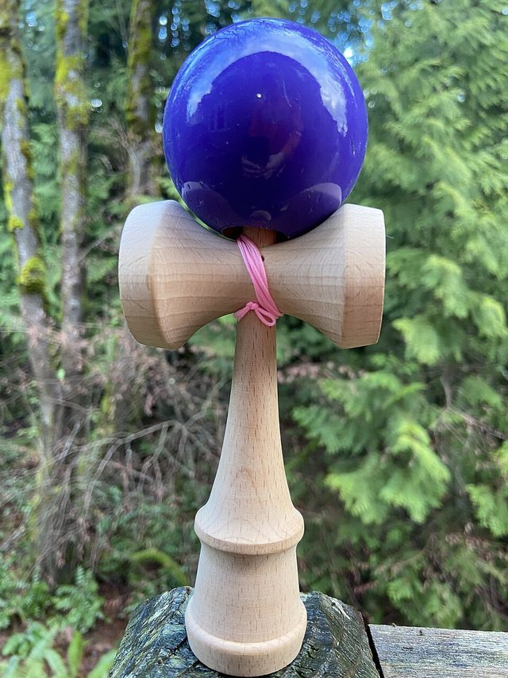

# Kendama

**Encyclopedia ID 850** (permanent) · https://bpupadhyaya.github.io/world-heritage-games-site/games/850-kendama/

*Photo: Gallaz63, [CC BY-SA 4.0](https://creativecommons.org/licenses/by-sa/4.0/), [source on Wikimedia Commons](https://commons.wikimedia.org/wiki/File:Kendama_toy.jpg)*

A handle with a ball on a string; players toss the ball and catch it on the spike or in the cups, building tricks.

## Heritage note

Part of the living heritage of Japan.

## Origins

Usually placed in the era of Modern Heritage (1800 to today), although its exact origins are uncertain, within the cultural world of Japan and Korea.

## Facts

- **Where:** Japan
- **Type:** Dexterity and skill games
- **Family:** Tops, kites and spinning toys
- **Era:** [Modern Heritage](../../eras/modern/index.md) (uncertain)
- **Cradle:** [Japan and Korea](../../cradles/japan-korea/index.md)
- **Region:** East and Southeast Asia
- **Players:** 1

## Play it

[Web preview](https://bpupadhyaya.github.io/games-site/games/kendama-ken-and-ball/) · [Google Play](https://play.google.com/store/apps/details?id=com.equalinformation.arcforge.shell) · [App Store](https://apps.apple.com/us/app/arcforge-world-heritage-games/id6813746442)

## Related entries

- [Amidakuji](../../games/357-amidakuji/index.md)
- [Hoop Rolling Trundle](../../games/69-hoop-rolling-trundle/index.md)
- [Spinning top](../../games/678-spinning-top/index.md)
- [Gasing uri](../../games/1289-gasing-uri/index.md)
- [Yo-yo](../../games/696-yo-yo/index.md)
- [Gasing](../../games/908-gasing/index.md)

## Sources

- <https://en.wikipedia.org/wiki/Kendama>
