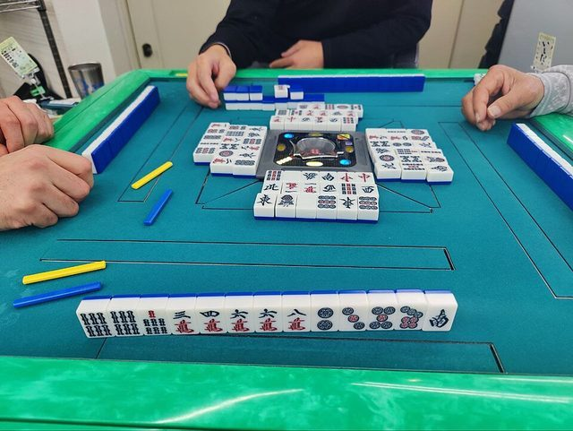

# Riichi mahjong

*Also known as: 麻雀 Mājan (riichi) · Japanese mahjong*

**Encyclopedia ID 851** (permanent) · https://bpupadhyaya.github.io/world-heritage-games-site/games/851-riichi-mahjong/

*Photo: Tairagi Makoto, [CC0](https://creativecommons.org/publicdomain/zero/1.0/), [source on Wikimedia Commons](https://commons.wikimedia.org/wiki/File:Riichi_Mahjong_real_autotable_session.jpg)*

Mahjong with a riichi declaration that stakes 1,000 points for a closed hand, plus dora bonus tiles and furiten rules.

## Heritage note

Part of the living heritage of Japan.

## Origins

Usually placed in the era of Crossroads and Golden Ages (about 500 to 1500), although its exact origins are uncertain, within the cultural world of Japan and Korea.

## Facts

- **Where:** Japan
- **Type:** Board and table games
- **Family:** Dominoes and tile games
- **Era:** [Crossroads and Golden Ages](../../eras/crossroads/index.md) (uncertain)
- **Cradle:** [Japan and Korea](../../cradles/japan-korea/index.md)
- **Region:** East and Southeast Asia
- **Players:** 4

## Related entries

- [Mahjong](../../games/635-mahjong/index.md)
- [Cafe dominoes](../../games/690-cafe-dominoes/index.md)
- [Rummikub](../../games/826-rummikub/index.md)
- [Chickenfoot](../../games/1193-chickenfoot/index.md)
- [Texas 42](../../games/1195-texas-42/index.md)
- [Bahamian dominoes](../../games/569-bahamian-dominoes/index.md)

## Sources

- <https://en.wikipedia.org/wiki/Japanese_mahjong>
- <https://en.wikipedia.org/wiki/Mahjong_culture>
