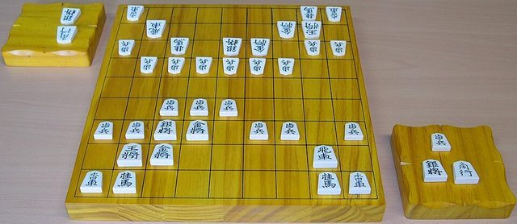

# Shogi

*Also known as: Japanese chess*

**Encyclopedia ID 852** (permanent) · https://bpupadhyaya.github.io/world-heritage-games-site/games/852-shogi/

*Photo: Oliver Orschiedt, [CC BY-SA 3.0](https://creativecommons.org/licenses/by-sa/3.0/), [source on Wikimedia Commons](https://commons.wikimedia.org/wiki/File:Shogi_board_pieces_and_komadai.jpg)*

Chess-like game on a 9x9 board in which captured pieces can be dropped back onto the board by the captor.

## Heritage note

Part of the living heritage of Japan.

## Origins

Usually placed in the era of Crossroads and Golden Ages (about 500 to 1500), although its exact origins are uncertain, within the cultural world of Japan and Korea.

## Facts

- **Where:** Japan
- **Type:** Board and table games
- **Family:** Chess family
- **Era:** [Crossroads and Golden Ages](../../eras/crossroads/index.md) (uncertain)
- **Cradle:** [Japan and Korea](../../cradles/japan-korea/index.md)
- **Region:** East and Southeast Asia
- **Players:** 2

## Play it

[Try a 90-second preview in your browser](https://bpupadhyaya.github.io/games-site/games/shogi-generals-and-drops/play/) · [Google Play](https://play.google.com/store/apps/details?id=com.equalinformation.arcforge.shell) · [App Store](https://apps.apple.com/us/app/arcforge-world-heritage-games/id6813746442)

## Related entries

- [Hasami shogi](../../games/849-hasami-shogi/index.md)
- [Janggi](../../games/1081-janggi/index.md)
- [Chaturanga](../../games/45-chaturanga/index.md)
- [Sittuyin](../../games/302-sittuyin/index.md)
- [Chess](../../games/552-chess/index.md)
- [Luzhanqi](../../games/640-luzhanqi/index.md)

## Sources

- <https://www.statista.com/statistics/1338888/japan-shogi-participation-rate/>
- <https://en.wikipedia.org/wiki/Shogi>
- <https://en.wikipedia.org/wiki/Japan_Shogi_Association>
