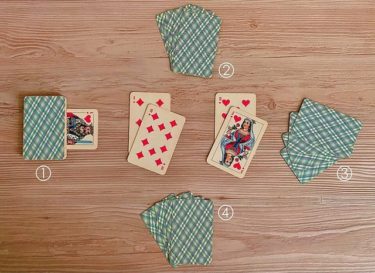

# Durak

*Also known as: Fool*

**Encyclopedia ID 854** (permanent) · https://bpupadhyaya.github.io/world-heritage-games-site/games/854-durak/

*Photo: Gzhegozh, [CC BY-SA 4.0](https://creativecommons.org/licenses/by-sa/4.0/), [source on Wikimedia Commons](https://commons.wikimedia.org/wiki/File:Russian_card_game_Durak.jpg)*

Russia's national card game: attack, defend, pile on cards, and avoid being the last holder.

## Heritage note

Part of the living heritage of Kazakhstan, Turkmenistan, Armenia.

## Origins

Usually placed in the era of Age of Contact and Craft (about 1500 to 1800), although its exact origins are uncertain, within the cultural world of Persia, Caucasus and Central Asia.

## Facts

- **Where:** Kazakhstan, Turkmenistan, Armenia, Azerbaijan, Georgia, Latvia
- **Type:** Card games
- **Era:** [Age of Contact and Craft](../../eras/contact/index.md) (uncertain)
- **Cradle:** [Persia, Caucasus and Central Asia](../../cradles/persia-central-asia/index.md)
- **Region:** South and Central Asia
- **Players:** 2-6

## Play it

[Try a 90-second preview in your browser](https://bpupadhyaya.github.io/games-site/games/durak-na-dache/play/) · [Google Play](https://play.google.com/store/apps/details?id=com.equalinformation.arcforge.shell) · [App Store](https://apps.apple.com/us/app/arcforge-world-heritage-games/id6813746442)

## Related entries

- [Panduri](../../games/41-panduri/index.md)
- [Dombra](../../games/48-dombra/index.md)
- [Duduk](../../games/159-duduk/index.md)
- [Lavash Baking](../../games/163-lavash-baking/index.md)
- [Kamancha](../../games/165-kamancha/index.md)
- [Kok-boru](../../games/241-kok-boru/index.md)

## Sources

- <https://en.wikipedia.org/wiki/Durak>
- <https://www.pagat.com/national/armenia.html>
- <https://www.onelowerlight.com/writing/life-in-georgia-is-like-a-game-of-backgammon/>
- <https://www.pagat.com/national/ukraine.html>
