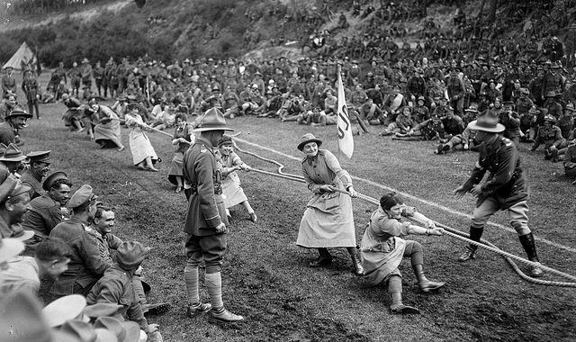

# Rope pulling

*Also known as: Arkan tartys · Tug of war · also known as tug o' war · tug-a-war · tug war · rope war*

**Encyclopedia ID 855** (permanent) · https://bpupadhyaya.github.io/world-heritage-games-site/games/855-rope-pulling/

*Photo: National Library NZ on The Commons, [Public domain](https://creativecommons.org/publicdomain/mark/1.0/), [source on Wikimedia Commons](https://commons.wikimedia.org/wiki/File:Queen_Mary%27s_Auxilary_Army_Corps_tug-o-war,_3_August_1918_(cropped).jpg)*

Two teams pull on a rope across a line, a tug-of-war form listed among traditional Kazakh games.

## Heritage note

Part of the living heritage of Kazakhstan.

## Origins

Usually placed in the era of Classical Worlds (about 1000 BCE to 500 CE), although its exact origins are uncertain, within the cultural world of Persia, Caucasus and Central Asia.

## Facts

- **Where:** Kazakhstan
- **Type:** Street and playground games
- **Era:** [Classical Worlds](../../eras/classical/index.md) (uncertain)
- **Cradle:** [Persia, Caucasus and Central Asia](../../cradles/persia-central-asia/index.md)
- **Region:** South and Central Asia
- **Players:** 2 teams

## Related entries

- [Kok-boru](../../games/241-kok-boru/index.md)
- [Kyz Kuu](../../games/858-kyz-kuu/index.md)
- [Kokpar](../../games/857-kokpar/index.md)
- [Buzkashi](../../games/226-buzkashi/index.md)
- [Chogan](../../games/810-chogan/index.md)
- [Chovqan](../../games/565-chovqan/index.md)

## Sources

- <https://central-asia.guide/kazakhstan/kazakh-culture/kazakh-games/>
- <https://welcome.kz/en/kazakhstan/national-games>
- <https://en.wikipedia.org/wiki/Tug_of_war>
