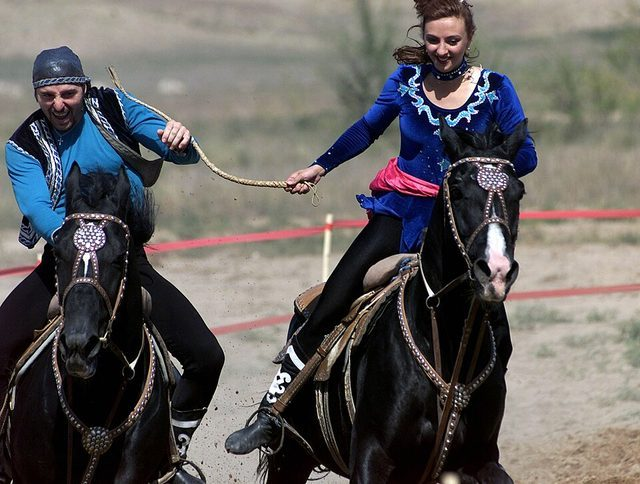

# Kyz Kuu

*Also known as: Catch the Girl*

**Encyclopedia ID 858** (permanent) · https://bpupadhyaya.github.io/world-heritage-games-site/games/858-kyz-kuu/

*Photo: SSGT JEREMY T. LOCK, [Public domain](https://creativecommons.org/publicdomain/mark/1.0/), [source on Wikimedia Commons](https://commons.wikimedia.org/wiki/File:Catchthegirl.JPG)*

A boy on horseback chases a girl who may whip him if caught; played at festivals and weddings.

## Heritage note

Part of the living heritage of Kazakhstan.

## Origins

Usually placed in the era of Classical Worlds (about 1000 BCE to 500 CE), although its exact origins are uncertain, within the cultural world of Persia, Caucasus and Central Asia.

## Facts

- **Where:** Kazakhstan
- **Type:** Street and playground games
- **Family:** Tag, chase and hide games
- **Era:** [Classical Worlds](../../eras/classical/index.md) (uncertain)
- **Cradle:** [Persia, Caucasus and Central Asia](../../cradles/persia-central-asia/index.md)
- **Region:** South and Central Asia
- **Players:** 2 riders

## Related entries

- [Moraingy drum-and-strike duel](../../games/207-moraingy-drum-and-strike-duel/index.md)
- [Circle Dodgeball](../../games/470-circle-dodgeball/index.md)
- [Al Ayyala Cane-Line Rhythm](../../games/1272-al-ayyala-cane-line-rhythm/index.md)
- [Kalinda Stick Duel](../../games/1467-kalinda-stick-duel/index.md)
- [Kok-boru](../../games/241-kok-boru/index.md)
- [Rope pulling](../../games/855-rope-pulling/index.md)

## Sources

- <https://central-asia.guide/kazakhstan/kazakh-culture/kazakh-games/>
- <https://welcome.kz/en/kazakhstan/national-games>
