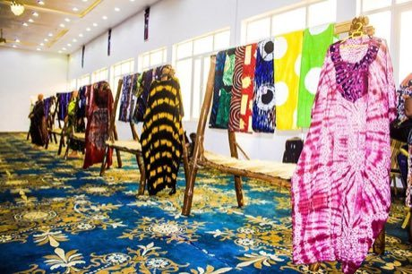

# Adire indigo resist dyeing

*Adire*

**Encyclopedia ID 87** (permanent) · https://bpupadhyaya.github.io/world-heritage-games-site/games/87-adire-indigo-resist-dyeing/

*Photo: Tunde Akangbe, [CC BY-SA 4.0](https://creativecommons.org/licenses/by-sa/4.0/), [source on Wikimedia Commons](https://commons.wikimedia.org/wiki/File:Adire_designs_on_stand.jpg)*

Tie, fold and stitch cloth to resist the dye, dip it in indigo, then unfold to see the pattern; recreate target patterns.

## Heritage note

Part of the living heritage of Nigeria.

## Origins

A living tradition passed from person to person; it is not tied to a single dated origin. It belongs to the cultural world of Africa: Sahel, West and Central.

## Facts

- **Where:** Nigeria
- **Type:** Crafts and making
- **Family:** Textile and weaving crafts
- **Era:** [Living Traditions](../../eras/living/index.md)
- **Cradle:** [Africa: Sahel, West and Central](../../cradles/africa-west/index.md)
- **Region:** Sub-Saharan Africa

## Related entries

- [Kente strip weaving](../../games/22-kente-strip-weaving/index.md)
- [Bolga Basket Weaver](../../games/1245-bolga-basket-weaver/index.md)
- [Faso Dan Fani Strip Weaving](../../games/1277-faso-dan-fani-strip-weaving/index.md)
- [Panu di Pinti Weaving](../../games/1357-panu-di-pinti-weaving/index.md)
- [Celtic knot weave](../../games/25-celtic-knot-weave/index.md)
- [Sashiko Stitch Patterns](../../games/27-sashiko-stitch-patterns/index.md)

## Sources

- <https://commons.wikimedia.org/wiki/File:Adire_designs_on_stand.jpg>
