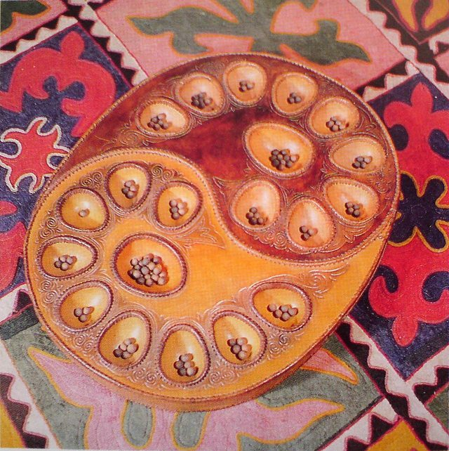

# Toguz Korgool

**Encyclopedia ID 871** (permanent) · https://bpupadhyaya.github.io/world-heritage-games-site/games/871-toguz-korgool/

*Photo: Arthoum, [CC BY-SA 3.0](https://creativecommons.org/licenses/by-sa/3.0/), [source on Wikimedia Commons](https://commons.wikimedia.org/wiki/File:%D0%A2%D0%BE%D0%B3%D1%83%D0%B7%D0%BA%D0%BE%D1%80%D0%B3%D0%BE%D0%BE%D0%BB.jpg)*

Nine-pit mancala with a tuzdyk capture, the same game as Togyzqumalaq.

## Heritage note

Part of the living heritage of Kyrgyzstan.

## Origins

Usually placed in the era of Deep Past and First Games (before about 3000 BCE), although its exact origins are uncertain, within the cultural world of Persia, Caucasus and Central Asia.

## Facts

- **Where:** Kyrgyzstan
- **Type:** Board and table games
- **Family:** Mancala and sowing games
- **Era:** [Deep Past and First Games](../../eras/deep-past/index.md) (uncertain)
- **Cradle:** [Persia, Caucasus and Central Asia](../../cradles/persia-central-asia/index.md)
- **Region:** South and Central Asia
- **Players:** 2

## Play it

[Web preview](https://bpupadhyaya.github.io/games-site/games/toguz-kumalak-nine-pits/play/) · [Google Play](https://play.google.com/store/apps/details?id=com.equalinformation.arcforge.shell) · [App Store](https://apps.apple.com/us/app/arcforge-world-heritage-games/id6813746442)

## Related entries

- [Songo](../../games/617-songo/index.md)
- [Bao](../../games/647-bao/index.md)
- [Kisolo](../../games/666-kisolo/index.md)
- [Oware](../../games/749-oware/index.md)
- [Pallanguzhi](../../games/798-pallanguzhi/index.md)
- [Congklak](../../games/803-congklak/index.md)

## Sources

- <https://central-asia.guide/kyrgyzstan/kyrgyz-culture/kyrgyz-games/>
- <https://en.wikipedia.org/wiki/2016_World_Nomad_Games>
- <https://en.wikipedia.org/wiki/Togyzkumalak>
- <https://burabai.kz/kazakhstan/kazakh-national-games-traditional-sports-cultural-heritage/>
