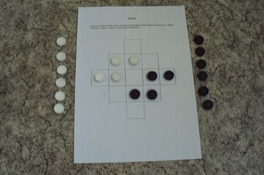

# Queah

*Queah · Liberian Queah*

**Encyclopedia ID 885** (permanent) · https://equalinformation.com/world-heritage-games-site/games/885-queah/

*Photo: Zákupák, [Public domain](https://creativecommons.org/publicdomain/mark/1.0/), [source on Wikimedia Commons](https://commons.wikimedia.org/wiki/File:Queah.jpg)*

Players jump and capture on a printed square board, much like draughts.

## Heritage note

Part of the living heritage of Liberia.

## Origins

Usually placed in the era of Crossroads and Golden Ages (about 500 to 1500), although its exact origins are uncertain, within the cultural world of Africa: Sahel, West and Central.

## Facts

- **Where:** Liberia
- **Type:** Board and table games
- **Family:** Draughts and capture games
- **Era:** [Crossroads and Golden Ages](../../eras/crossroads/index.md) (uncertain)
- **Cradle:** [Africa: Sahel, West and Central](../../cradles/africa-west/index.md)
- **Region:** Sub-Saharan Africa
- **Players:** 2

## Related entries

- [Yote Capture Grid](../../games/167-yote-capture-grid/index.md)
- [Dhamet](../../games/927-dhamet/index.md)
- [Turkish Dama](../../games/155-turkish-dama/index.md)
- [Peralikatuma](../../games/287-peralikatuma/index.md)
- [Kharbaga](../../games/459-kharbaga/index.md)
- [Sholo Guti](../../games/461-sholo-guti/index.md)

## Sources

- <https://lessonplans.craftgossip.com/play-a-traditional-liberian-strategy-game/>
- <https://commons.wikimedia.org/wiki/File:Queah.jpg>
