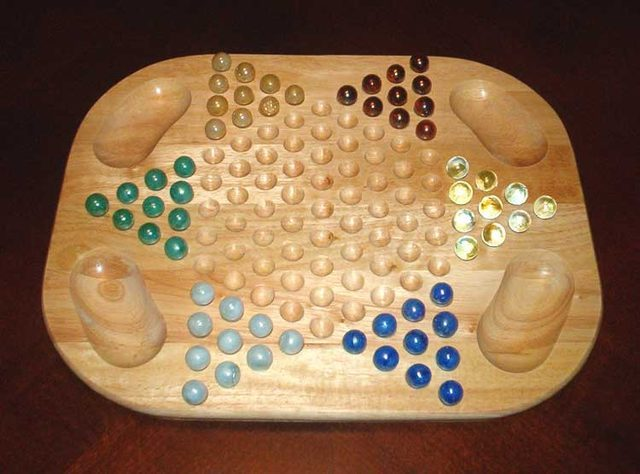

# Chinese Checkers

*Also known as: Sternhalma · Chinese chequers*

**Encyclopedia ID 8870** (permanent) · https://bpupadhyaya.github.io/world-heritage-games-site/games/8870-chinese-checkers/

*Photo: The original uploader was Hephaestos at English Wikipedia ., [CC BY-SA 3.0](https://creativecommons.org/licenses/by-sa/3.0/), [source on Wikimedia Commons](https://commons.wikimedia.org/wiki/File:ChineseCheckersboard.jpeg)*

Star-shaped board race game, of German origin, for two to six players played individually or in teams.

## How it is played

Players hop or step marbles across the star board to reach the opposite corner first.

## Heritage note

Part of the living heritage of Germany.

## Origins

Usually placed in the era of Deep Past and First Games (before about 3000 BCE), although its exact origins are uncertain, within the cultural world of Northern and Eastern Europe.

## Facts

- **Where:** Germany
- **Type:** Board and table games
- **Family:** Draughts and capture games
- **Era:** [Deep Past and First Games](../../eras/deep-past/index.md) (uncertain)
- **Cradle:** [Northern and Eastern Europe](../../cradles/north-east-europe/index.md)
- **Region:** Europe
- **Players:** 2-6

## Play it

[Try a 90-second preview in your browser](https://bpupadhyaya.github.io/games-site/games/halma-hop-and-leap/play/) · [Google Play](https://play.google.com/store/apps/details?id=com.equalinformation.arcforge.shell) · [App Store](https://apps.apple.com/us/app/arcforge-world-heritage-games/id6813746442)

## Related entries

- [Shashki](../../games/1177-shashki/index.md)
- [Czech draughts](../../games/662-czech-draughts/index.md)
- [Polish draughts](../../games/1034-polish-draughts/index.md)
- [Turkish Dama](../../games/155-turkish-dama/index.md)
- [Yote Capture Grid](../../games/167-yote-capture-grid/index.md)
- [Peralikatuma](../../games/287-peralikatuma/index.md)

## Sources

- <https://en.wikipedia.org/wiki/Chinese_checkers>
