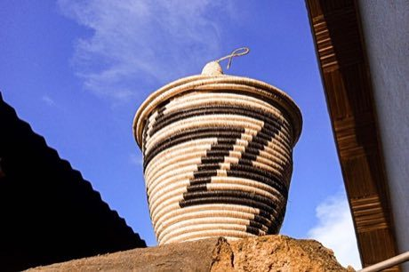

# Agaseke basket weaving

*Also known as: Agaseke · Igiseke*

**Encyclopedia ID 89** (permanent) · https://bpupadhyaya.github.io/world-heritage-games-site/games/89-agaseke-basket-weaving/

*Photo: Honorine Umutoni, [CC BY-SA 4.0](https://creativecommons.org/licenses/by-sa/4.0/), [source on Wikimedia Commons](https://commons.wikimedia.org/wiki/File:Agaseke_keza.jpg)*

Coil sisal and grass in rising rings, switch colours at the right turns to make triangles and zigzags, finish with a lid.

## Heritage note

Part of the living heritage of Rwanda.

## Origins

A living tradition passed from person to person; it is not tied to a single dated origin. It belongs to the cultural world of Africa: Great Lakes and Indian Ocean.

## Facts

- **Where:** Rwanda
- **Type:** Crafts and making
- **Family:** Textile and weaving crafts
- **Era:** [Living Traditions](../../eras/living/index.md)
- **Cradle:** [Africa: Great Lakes and Indian Ocean](../../cradles/africa-east/index.md)
- **Region:** Sub-Saharan Africa

## Related entries

- [Kiondo basket weaving](../../games/194-kiondo-basket-weaving/index.md)
- [Kente strip weaving](../../games/22-kente-strip-weaving/index.md)
- [Celtic knot weave](../../games/25-celtic-knot-weave/index.md)
- [Sashiko Stitch Patterns](../../games/27-sashiko-stitch-patterns/index.md)
- [Adire indigo resist dyeing](../../games/87-adire-indigo-resist-dyeing/index.md)
- [Toquilla straw hat weaving](../../games/93-toquilla-straw-hat-weaving/index.md)

## Sources

- <https://commons.wikimedia.org/wiki/File:Agaseke_keza.jpg>
