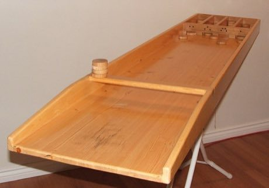

# Sjoelen

*Also known as: Sjoelbak · Dutch shuffleboard · Dutch Table Shuffleboard*

**Encyclopedia ID 9** (permanent) · https://bpupadhyaya.github.io/world-heritage-games-site/games/9-sjoelen/

*Photo: Jonny German, [Public domain](https://creativecommons.org/publicdomain/mark/1.0/), [source on Wikimedia Commons](https://commons.wikimedia.org/wiki/File:Sjoelbak.jpg)*

Flick 30 wooden discs along a long board so they pass through four numbered gates; score the gates, then re-flick leftover discs for second and third rounds.

## Heritage note

Part of the living heritage of Netherlands.

## Origins

Usually placed in the era of Modern Heritage (1800 to today), although its exact origins are uncertain, within the cultural world of Celtic and Atlantic Europe.

## Facts

- **Where:** Netherlands
- **Type:** Dexterity and skill games
- **Family:** Puzzle and dexterity toys
- **Era:** [Modern Heritage](../../eras/modern/index.md) (uncertain)
- **Cradle:** [Celtic and Atlantic Europe](../../cradles/celtic-atlantic/index.md)
- **Region:** Europe
- **Players:** 1-4

## Related entries

- [Disc-flip](../../games/8-disc-flip/index.md)
- [Shove ha'penny](../../games/54-shove-hapenny/index.md)
- [Cynghanedd Poetry Puzzle](../../games/1448-cynghanedd-poetry-puzzle/index.md)
- [Diabolo](../../games/5023-diabolo/index.md)
- [Pitch and toss](../../games/822-pitch-and-toss/index.md)
- [Crossword](../../games/22326-crossword/index.md)

## Sources

- <https://commons.wikimedia.org/wiki/File:Sjoelbak.jpg>
- <https://en.wikipedia.org/wiki/Sjoelen>
