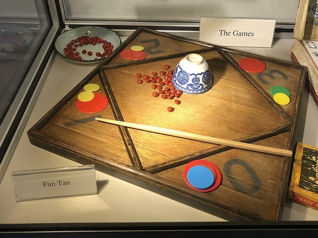

# Fan-tan

**Encyclopedia ID 900** (permanent) · https://bpupadhyaya.github.io/world-heritage-games-site/games/900-fan-tan/

*Photo: Fuzheado ( talk ), [CC BY-SA 3.0](https://creativecommons.org/licenses/by-sa/3.0/), [source on Wikimedia Commons](https://commons.wikimedia.org/wiki/File:Fan-Tan.jpg)*

Players bet on the remainder (1 to 4) after a pile of buttons or beads is counted off in fours.

## Heritage note

Part of the living heritage of China.

## Origins

A living tradition passed from person to person; it is not tied to a single dated origin. It belongs to the cultural world of China.

## Facts

- **Where:** China
- **Type:** Other traditions
- **Era:** [Living Traditions](../../eras/living/index.md) (uncertain)
- **Cradle:** [China](../../cradles/china/index.md)
- **Region:** East and Southeast Asia
- **Players:** 2+

## Related entries

- [Chinese knotting](../../games/26-chinese-knotting/index.md)
- [Tanghua](../../games/64-tanghua/index.md)
- [Chuiwan](../../games/332-chuiwan/index.md)
- [Bianzhong](../../games/336-bianzhong/index.md)
- [Gongfu tea pour](../../games/339-gongfu-tea-pour/index.md)
- [Lamian](../../games/340-lamian/index.md)

## Sources

- <https://en.wikipedia.org/wiki/Fan-tan>
