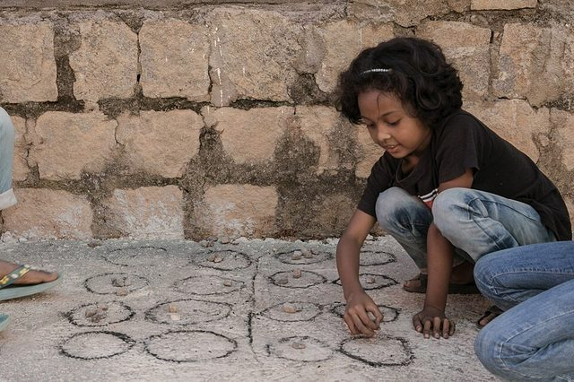

# Katro / Katra

*Also known as: Katro · Fifangha*

**Encyclopedia ID 903** (permanent) · https://bpupadhyaya.github.io/world-heritage-games-site/games/903-katro-katra/

*Photo: RANDRIANADRASANA Obiniaina, [CC BY-SA 4.0](https://creativecommons.org/licenses/by-sa/4.0/), [source on Wikimedia Commons](https://commons.wikimedia.org/wiki/File:Katro.jpg)*

Betsileo mancala.

## Heritage note

Part of the living heritage of Madagascar.

## Origins

Usually placed in the era of Deep Past and First Games (before about 3000 BCE), although its exact origins are uncertain, within the cultural world of Africa: Great Lakes and Indian Ocean.

## Facts

- **Where:** Madagascar
- **Type:** Board and table games
- **Family:** Mancala and sowing games
- **Era:** [Deep Past and First Games](../../eras/deep-past/index.md) (uncertain)
- **Cradle:** [Africa: Great Lakes and Indian Ocean](../../cradles/africa-east/index.md)
- **Region:** Sub-Saharan Africa
- **Players:** 2

## Related entries

- [Bao](../../games/647-bao/index.md)
- [Igisoro](../../games/1049-igisoro/index.md)
- [Bao la Kiswahili](../../games/861-bao-la-kiswahili/index.md)
- [Highland and river mancalas](../../games/863-highland-and-river-mancalas/index.md)
- [Bawo](../../games/906-bawo/index.md)
- [Makonn](../../games/1065-makonn/index.md)

## Sources

- <https://en.wikipedia.org/wiki/Katro>
