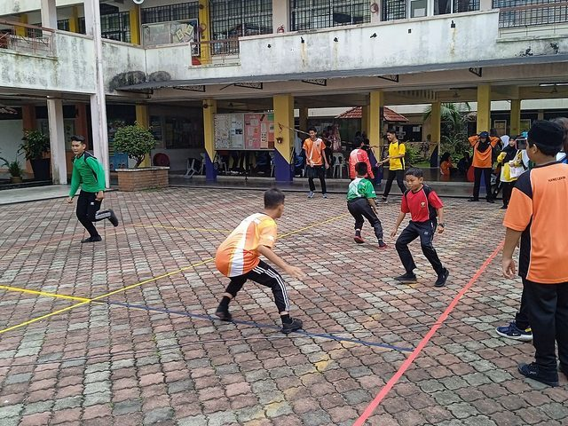

# Galah panjang

**Encyclopedia ID 909** (permanent) · https://bpupadhyaya.github.io/world-heritage-games-site/games/909-galah-panjang/

*Photo: Wiki Farazi, [CC0](https://creativecommons.org/publicdomain/zero/1.0/), [source on Wikimedia Commons](https://commons.wikimedia.org/wiki/File:Hari_Sukan_Negara_(HSN)_2023_SMK_Seksyen_4_Kota_Damansara_20231014_091348.jpg)*

Line-crossing tag game; attackers try to cross all lines and return.

## Heritage note

Part of the living heritage of Malaysia, Singapore.

## Origins

Usually placed in the era of Deep Past and First Games (before about 3000 BCE), although its exact origins are uncertain, within the cultural world of Southeast Asia and the Islands.

## Facts

- **Where:** Malaysia, Singapore
- **Type:** Street and playground games
- **Family:** Tag, chase and hide games
- **Era:** [Deep Past and First Games](../../eras/deep-past/index.md) (uncertain)
- **Cradle:** [Southeast Asia and the Islands](../../cradles/southeast-asia/index.md)
- **Region:** East and Southeast Asia
- **Players:** 6+

## Related entries

- [Tag](../../games/959-tag/index.md)
- [Patintero](../../games/1021-patintero/index.md)
- [Hide and Seek](../../games/475-hide-and-seek/index.md)
- [Brännboll](../../games/1118-brannboll/index.md)
- [Ziziros](../../games/659-ziziros/index.md)
- [Fijian tag](../../games/712-fijian-tag/index.md)

## Sources

- <https://heritage.gov.my/en/pengenalan-cawangan-adat-budaya/permainan-tradisi.html>
- <https://en.wikipedia.org/wiki/Traditional_games_of_Singapore>
