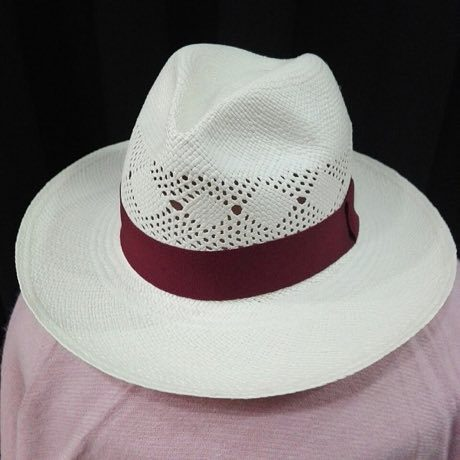

# Toquilla straw hat weaving

*Sombrero de paja toquilla*

**Encyclopedia ID 93** (permanent) · https://equalinformation.com/world-heritage-games-site/games/93-toquilla-straw-hat-weaving/

*Photo: Javier Mate, [CC BY-SA 4.0](https://creativecommons.org/licenses/by-sa/4.0/), [source on Wikimedia Commons](https://commons.wikimedia.org/wiki/File:Panama_clasic_semicalado_brisa_en_Araras_Wi.jpg)*

Weave pale straw strands outward from the crown centre in an over-under pattern, keeping tension and following a pattern chart until the brim is closed.

## Heritage note

Part of the living heritage of Ecuador.

## Origins

A living tradition passed from person to person; it is not tied to a single dated origin. It belongs to the cultural world of The Americas: Andes and South America.

## Facts

- **Where:** Ecuador
- **Type:** Crafts and making
- **Family:** Textile and weaving crafts
- **Era:** [Living Traditions](../../eras/living/index.md)
- **Cradle:** [The Americas: Andes and South America](../../cradles/andes-south-america/index.md)
- **Region:** Americas

## Related entries

- [Nanduti](../../games/428-nanduti/index.md)
- [Kente strip weaving](../../games/22-kente-strip-weaving/index.md)
- [Celtic knot weave](../../games/25-celtic-knot-weave/index.md)
- [Sashiko Stitch Patterns](../../games/27-sashiko-stitch-patterns/index.md)
- [Adire indigo resist dyeing](../../games/87-adire-indigo-resist-dyeing/index.md)
- [Agaseke basket weaving](../../games/89-agaseke-basket-weaving/index.md)

## Sources

- <https://commons.wikimedia.org/wiki/File:Panama_clasic_semicalado_brisa_en_Araras_Wi.jpg>
